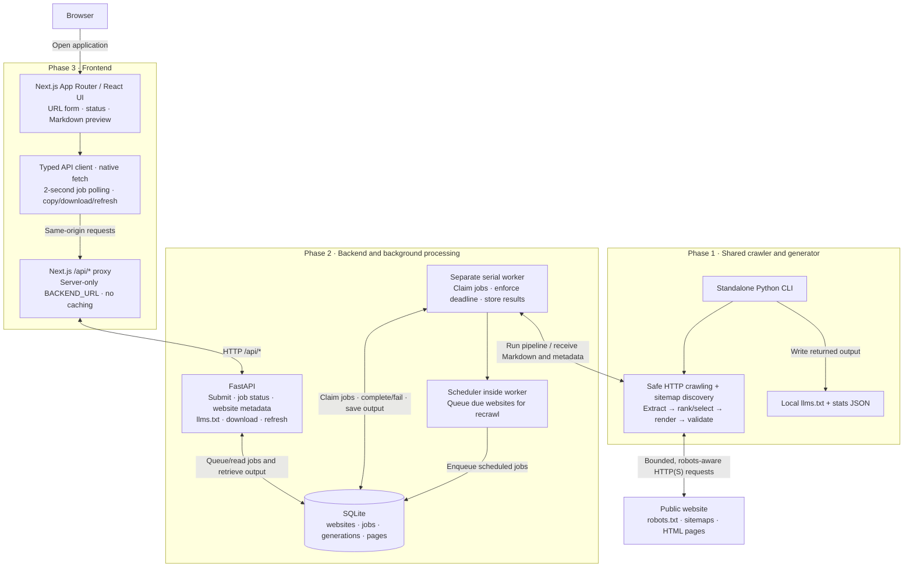

# Automated llms.txt Generator

Generate a structured llms.txt from a public website. A Next.js frontend connects
to the deterministic Python crawler through FastAPI, with SQLite persistence,
a separate serial worker, and automatic scheduled recrawls. No LLM key, Docker,
Redis, or external database is required. The standalone CLI remains available.

**Status:** Phases 1–3 are complete. Frontend lint, type checking, production
build, 44 mocked browser tests, and one live browser integration test pass.
146 backend pytest tests and 10 subtests pass, including the crawler coverage
and benchmark regression tests. Two deployment safeguard tests also pass.
A real `example.com` end-to-end run passed on October 15, 2026: initial generation,
download, manual refresh, automatic recrawl, unchanged-output deduplication, and
persistence across an API restart. Selection-quality limitations remain; the
new [coverage benchmark](backend/benchmarks/README.md) measures them explicitly.
The older five-site report is in the local `TESTING.md` if available. Phase 4 adds a
Render deployment configuration; public deployment is pending verification.

This is the project's cumulative README. Changes and setup instructions are
grouped by phase below, newest first, with earlier phases preserved.

| Phase | Changes introduced | Status |
| --- | --- | --- |
| [Phase 1 — Crawler and CLI](#phase-1--crawler-and-cli) | Safe crawling, extraction, ranking, Markdown generation/validation, and a standalone CLI | Complete |
| [Phase 2 — Backend](#phase-2--backend-api-persistence-and-automatic-refresh) | FastAPI routes, SQLite persistence, background jobs, manual refresh, and scheduled recrawls | Complete |
| [Phase 3 — Frontend](#phase-3--frontend) | Next.js interface, API proxy, job polling/recovery, preview, copy/download, regeneration, and browser tests | Complete |
| [Phase 4 — Managed deployment](#phase-4--managed-deployment-render) | One Render service, persistent SQLite, process supervision, submission limits, backups, and operations | Configuration prepared; live verification pending |

**Tutorials:** [Run locally](#run-locally) · [Deploy to Render](#phase-4--managed-deployment-render) · [Alternative: VPS](#deployment-guide--single-ubuntu-vps)

## URL shortcut

Append a public website to the app's address to start generating automatically:

```text
http://localhost:3000/example.com
http://localhost:3000/https://example.com/docs/
```

Replace `http://localhost:3000` with the deployed app's origin when hosted.
Bare domains default to HTTPS; explicit HTTP and HTTPS URLs are supported.
Paths, trailing slashes, and query parameters are passed to the existing crawler.
The app redirects to its generation screen, fills in the target URL, and shows
the usual progress, preview, copy, and download controls. Crawling still takes
time and follows the same public-URL validation, robots rules, crawl scope,
submission limits, and page budgets as manual submission.

Once submitted, the address includes the target and job ID. Reloading or sharing
that resulting link reopens the job, including a completed result, without
submitting a new crawl. Use **Regenerate** to request a fresh crawl. Opening the
original shortcut again requests generation (reusing an active job for the same
normalized target). A new shortcut target takes precedence over another job
saved in the browser. A missing job shows an error and lets you submit again.

For URLs with fragments or unusual escaping, use the query form with a
URL-encoded target, for example
`/?url=https%3A%2F%2Fexample.com%2Fdocs%3Fversion%3D2`.
Fragments in a directly pasted shortcut are browser-only and are not submitted.
The generated file can be downloaded; this does not publish it to the target site.

Verified with lint, TypeScript checking, a production build, 44 desktop/mobile
browser tests, and a real `example.com` crawl through the production frontend,
API, and worker. The live check also covers reload, copy, download, and refresh.

## Website coverage improvements

The crawler prioritizes pages **before fetching them**. Homepage navigation,
section overviews, link labels, depth, and repeated incoming links influence the
queue. Visits are balanced across URL sections; product pages can be reached
before exhausting category links, and one sitemap section cannot fill the entire
candidate sample. Image-map links and image alt labels support older navigation.
The output still uses a separate ranking/selection step after crawling.

Sitemap files and gzip indexes now use incremental parsing instead of loading
whole documents or keeping them in the response cache. Ordinary pages retain
their 2 MB limit. Sitemap defaults are 50 MiB of XML per file, 10 MiB compressed,
50,000 entries per file, 64 MiB of XML across discovery, and 30 seconds for
discovery (an in-progress network read also has its request timeout). Up to 12
sitemap documents are requested and at most 5,000 candidate URLs are retained;
section quotas may retain fewer. Documents that fail XML/gzip validation do not
publish their partial candidates. Reaching a byte/time limit records a warning
and continues with navigation and any earlier valid maps. DTDs, entities, deep
nesting, oversized fields, malformed gzip, and trailing gzip members are rejected.
These are resource limits, not a promise to enumerate every URL of a large site.

Bare hostnames and their exact `www` counterparts are supported, including
redirects, with public-IP validation for every connection and independent
robots.txt checks for each destination origin. Subdomains such as `docs.example.com`
remain outside scope. Same-site HTTP links or redirect locations encountered on
HTTPS are retried over HTTPS; the crawler does not follow a plaintext downgrade.
Original alias URLs are not assumed equivalent: only fetched content and verified
canonicals can collapse them.

Known tracking parameters (`utm_*`, `gclid`, `fbclid`, `msclkid`, `mc_cid`, `mc_eid`,
`_ga`) are removed. Other query values, their order, repeated keys, and escaping
are preserved. Discovered sorting/session/pagination parameters are filtered,
and only five query variants per hostname/path are admitted by default. There
are also eight-field and 2,048-character limits for discovered URLs. This supports
content such as `?page_id=123` while keeping parameter combinations bounded.

Page crawling defaults to the submitted directory. For example,
`https://docs.python.org/3/` stays inside `/3/`, including sitemap-discovered pages
and redirect destinations. Root-level robots.txt and sitemap documents remain
accessible for discovery and permission checks. Trailing-slash and extensionless
URLs denote directories; a filename such as `/docs/index.html` uses `/docs/`.
Use `--crawl-scope site` in the CLI or `LLMS_CRAWL_SCOPE=site` in the worker's
environment to traverse the entire hostname. The web app uses the worker's
setting; automatic recrawls use it too. No database migration is needed.

Identical extracted content, titles, and descriptions now collapse to one fetched
URL even without canonical tags. Matching content with a fetched canonical
target also confirms an alias. The submitted page is preferred, followed by a
verified canonical target; cycles retain one representative. Pages with different
metadata remain separate unless a canonical confirms the match. All fetched
aliases contribute their outgoing links before deduplication. CLI stats report
`duplicates_removed` and selected-page URLs/content lengths.
Archive and ebook downloads are excluded from page traversal so they do not
consume the HTML crawl budget.

The [12-site coverage benchmark](backend/benchmarks/README.md) measures expected
key-page coverage, content length, duplicates, scope, failures, and runtime.
It separates automated candidates from manually reviewed quality passes and
retains failed/blocked sites in its results. The
[October 16 live report](backend/benchmarks/results-2026-10-16.md) records 7
automated candidates, 3 cases needing review, and 2 partial crawls; manual quality
reviews remain pending. The newer
[crawler improvements comparison](backend/benchmarks/results-crawler-improvements.md)
records 11 automated candidates using those original expectations, plus a
separately successful NASA rerun after correcting its current navigation URL.
No manually reviewed quality pass is claimed. Run from `backend/`:

```sh
python -m app.benchmark --only example --only python-docs
python -m app.benchmark --max-pages 20  # all 12 sites, deployment page budget
```

JavaScript rendering remains unsupported. This batch adds measurement and
improves HTTP crawling; it does not establish universal website compatibility.

## Run locally

Use **three terminals**, all starting in the repository root. Prerequisites:
Python 3.11+, Node.js 24 LTS (recommended), npm, and Git. No API keys or external
database are needed. The commands below use macOS/Linux shell syntax.

**Terminal 1 — install and start FastAPI:**

```sh
cd backend
python3 -m venv .venv
source .venv/bin/activate
python -m pip install -r requirements.txt
test -f .env || cp .env.example .env
set -a
source .env
set +a
uvicorn app.api.main:app --host 127.0.0.1 --port 8000 --reload
```

For subsequent runs, skip creating the virtual environment and installing
dependencies unless they have changed. Preserve any existing customized `.env`.

**Terminal 2 — start the worker and automatic recrawl scheduler:**

```sh
cd backend
source .venv/bin/activate
set -a
source .env
set +a
python -m app.worker
```

API and worker must load the **same** `backend/.env` and database path. Keep this
terminal running: without the worker, submissions remain queued. Only one worker
may use a database at a time; no separate scheduler process is needed.

**Terminal 3 — install and start Next.js:**

```sh
cd frontend
# If you use nvm: nvm install && nvm use
npm ci
test -f .env.local || cp .env.example .env.local
npm run dev -- --hostname 127.0.0.1
```

The frontend environment should contain `BACKEND_URL=http://127.0.0.1:8000`
(without `/api`). Next.js loads `.env.local` automatically. For later runs,
`npm run dev -- --hostname 127.0.0.1` is sufficient if dependencies are unchanged.

| Open | Address |
| --- | --- |
| Application | <http://localhost:3000> |
| FastAPI interactive documentation | <http://127.0.0.1:8000/docs> |
| API/database health | <http://127.0.0.1:8000/api/health> |
| Same health endpoint through the frontend proxy | <http://localhost:3000/api/health> |

Enter `https://example.com` in the app, generate, wait for completion, then try
copy, download, and regenerate. Larger sites may take a few minutes. Stop each
terminal with **Ctrl+C**. SQLite data remains in `backend/data/` with the example
configuration. Logs appear in the API/worker terminals; queued work resumes when
the worker starts again. For a production-mode local check, replace the third
terminal's dev command with `npm run build` followed by `npm start`.

## Architecture



FastAPI queues work and serves persisted results; the separate worker performs
crawls. SQLite holds both the job queue and generation history. The scheduler
runs inside the worker, so there is no Redis queue or additional scheduler
service. Both CLI and worker reuse the same crawl/generation pipeline. The
browser accesses FastAPI through Next.js, which avoids cross-origin requests.
Downloading a file does not publish it to the submitted website.

## Phase 4 — Managed deployment (Render)

**Status: not deployed or publicly verified yet.** The deployment target changed
from an Ubuntu VPS to managed hosting for a short take-home demonstration.
The original VPS tutorial below remains an alternative. No VPS, SSH access,
custom domain, Nginx installation, or manual certificate management is needed
for the Render configuration. Phase 4 must remain incomplete until a real public
HTTPS deployment passes the checks below.

### Deployment configuration

`render.yaml` defines one Python-native Render web service. Render's native
runtimes also include Node/npm. `.node-version` selects Node 24 and
`.python-version` selects Python 3.13; exact patch versions are printed in build
logs. There is no Docker image or database migration.
([Render runtimes](https://render.com/docs/native-runtimes))

```text
Browser → Render HTTPS → Next.js 0.0.0.0:$PORT
                            → FastAPI 127.0.0.1:8000
                                     ↕
                          /var/data/llms.sqlite3
                                     ↕
                          one worker + scheduler
```

The same three existing application processes run inside one service to share
the persistent disk. `deploy/run.py` starts them, forwards shutdown signals, and
stops the entire group if any child exits so the platform can restart it.
The existing worker lock prevents a second worker using the database. Do not
add a separate Render worker or scale this service to multiple instances.

| Setting | Configured value |
| --- | --- |
| Repository | `https://github.com/yejessica/llms-txt-jessica-ye` |
| Service name | `llms-txt-jessica-ye` (actual public URL assigned by Render) |
| Runtime / region | Python native / Virginia |
| Workspace / compute | Hobby / `0.5c-512mb` (formerly Starter), 512 MB |
| Disk | 1 GB mounted at `/var/data` |
| API and worker database | `LLMS_DB_PATH=/var/data/llms.sqlite3` |
| Next.js backend origin | Server-only `BACKEND_URL=http://127.0.0.1:8000` |
| Build / start | `bash deploy/build.sh` / `python -m deploy.run` |
| Public health check | `/api/health`, through the existing Next.js proxy |
| Crawling | 20 pages, depth 2, 180-second job deadline, 1-second request delay |
| Automatic recrawl | Every 86,400 seconds, inside the sole worker |
| Submission limit | Shared demo bucket: 6/minute, burst 3; generation and refresh only |
| Backups | After 30 seconds of uptime, then daily; retain newest 7 snapshots |
| Auto deploy | Off; manually deploy a tested commit |

The small instance is a starting point for this temporary demonstration, not a
verified capacity guarantee. Its Node runtime heap is capped at 192 MB; the
build gets a separate 2 GB heap cap. Monitor Render's memory metrics during real
crawls. Upgrade compute if memory pressure prevents reliable operation.

The Hobby workspace has no subscription fee. Compute is $7/month plus
$0.25/month for a 1 GB disk, prorated to the second (roughly $0.24/day before
taxes, bandwidth, or build overages). Check Render's review screen before
creating resources. A free service cannot attach a persistent disk and can
sleep, so this configuration uses paid compute.
([Pricing](https://render.com/pricing), [billing](https://render.com/docs/faq),
[free service limitations](https://render.com/docs/free))

### Create the deployment

1. Sign in to Render using a Hobby workspace. Add a payment method when prompted.
2. Open [Deploy to Render](https://render.com/deploy?repo=https://github.com/yejessica/llms-txt-jessica-ye).
   This imports the repository's `render.yaml`. Keep the repository root as the
   service root so both `backend/` and `frontend/` are available.
3. Review the single service and disk, then create the Blueprint. Do not add
   Postgres, Redis, a separate worker, or a paid workspace upgrade.
4. Wait for the build and deployment. The build runs backend and deployment
   tests, frontend lint/type checking, and the production build. If it fails,
   inspect Events/build logs before retrying.
5. Open the assigned `https://...onrender.com` address and run the public checks
   below. Render supplies HTTP-to-HTTPS redirects and manages TLS renewal.
   ([TLS documentation](https://render.com/docs/tls))

If configuring manually instead of using the Blueprint, copy the commands,
environment variables, compute plan, disk, and health path from `render.yaml`.
Do not use `frontend/` as the root directory or start the development server.
The persistent disk is available only at runtime; the build never initializes
the live database.

### Verification record

Local verification on October 15, 2026:

- Existing backend suite: 89 tests and 10 subtests passed (one existing Starlette
  deprecation warning).
- Deployment safeguards: 2 tests passed. Submission throttling leaves polling
  unrestricted; an open WAL database produces a consistent snapshot; isolated
  recovery verifies rows, stored Markdown hashes, foreign keys, and writes.
- Frontend lint, type checking, and Node 24 production webpack build passed.
- All 26 desktop/mobile browser tests passed, including the new HTTP 429 error
  message. The real local production integration test passed against
  `example.com`, checking proxy submission, polling, preview, clipboard bytes,
  download bytes, regeneration, and private-IP rejection.
- A separate local check of the actual `deploy.run` production launcher passed:
  real crawl and refresh, proxy health, rate-limited submissions with unrestricted
  polling, automatic verified backup, mode-0600 database, cleanup after a killed
  worker, persisted output after a launcher restart, and graceful shutdown.
  These used temporary storage, Node 24.22.0 and Python 3.13.2 on macOS.
- Public HTTPS, real deployed crawl, UI copy/download/regeneration, mobile
  layout, platform restart/persistence, disk permissions, logs, and actual backup
  output: **pending**. Local checks do not prove the Render service works.

Before declaring deployment complete, record the assigned URL, deployed commit,
runtime versions, public homepage/health responses and HTTPS redirect, completed
job ID and metadata for `https://example.com`, preview/copy/download equality,
regeneration, safe error responses and HTTP 429 behavior, mobile layout, memory
metrics, logs, backup verification, and persistence after a service restart.
TLS renewal is platform-managed; distinguish the verified live certificate from
a future renewal that has not yet occurred.

### Operations, backups, rollback, and teardown

Use the service's Render dashboard:

- **Logs**: combined API, worker, frontend, and supervisor logs. The supervisor
  labels each child PID; the worker logs completed or failed jobs.
- **Metrics**: memory/CPU and disk usage; watch for out-of-memory exits.
- **Manual Deploy → Restart service**: restart all three processes. Afterward,
  check `/api/health` and retrieve a previously generated file. Interrupted jobs
  are recovered by the worker's existing recovery path.
- **Manual Deploy → Deploy a specific commit**: deploy a tested Git revision.
  Roll back by deploying the previously verified compatible commit. Disk data
  persists. Do not restore an older database unless data rollback is intended.

In the Render **Shell**, with the service's environment:

```sh
python deploy/backup.py
ls -l /var/data /var/data/backups
python deploy/backup.py --verify /var/data/backups/CHOSEN_SNAPSHOT.sqlite3
```

Snapshots use Python's SQLite online backup API, convert the snapshot to a
self-contained rollback-journal file, and check an isolated restored copy before
publishing the snapshot. Verification never opens the live database for writes.
The source remains in WAL mode. Generated files have mode 0600 under a private
umask. This is a database backup, not an off-platform disaster-recovery service.
Download a chosen snapshot privately before deleting the service/disk. Render's
disk snapshots are not a substitute for a SQLite-consistent backup.

For a data restore, stop all application processes first. Preserve the existing
database, WAL, and SHM as a matched set; install a verified snapshot without old
WAL/SHM files and restart. The supervisor restarts stopped children, so do not
replace live files in an ordinary Shell session. Use a temporary maintenance
start command with application children disabled for a controlled restore.
Rehearse using `--verify` first; no live data restore has been performed.

After the deadline, download anything to retain, then delete this service and
its disk in Render and check Billing for remaining resources. Merely turning
off auto-deploy does not stop hosting charges.

### Remaining limitations

- The public deployment has not yet been verified; the 512 MB memory budget is
  unproven until tested on Render.
- The limiter is shared across demo visitors, resets on restart, and is not a
  per-user quota. GET polling, metadata, preview, health, and downloads are not
  limited. HTTP 429 shows a useful busy message and preserves `Retry-After`.
- No authentication or ownership isolation; generated website results are
  accessible by their IDs. Keep this a small temporary review demonstration.
- Health covers Next.js → API → database, not an independently proven crawl.
  Supervisor exit monitoring detects a stopped child, not a hung worker.
- One service and disk mean deployments/restarts have brief downtime. Backups
  on that disk do not protect against deletion or loss of the hosting account.
- Crawling remains serial, bounded, and robots-aware. JavaScript-only websites,
  robots restrictions, and site throttling retain the earlier limitations.

## Phase 3 — Frontend

### Run the frontend locally

Run the backend API and worker in two terminals using the commands in the next
section. Then, in a third terminal from the repository root:

```sh
cd frontend
# Recommended: Node.js 24 LTS; `nvm install && nvm use` uses .nvmrc if you use nvm.
npm ci
cp .env.example .env.local  # first run only; preserve any existing custom settings
npm run dev
```

Open <http://localhost:3000>. FastAPI runs at <http://localhost:8000>. Next.js
automatically loads its environment files; the Python API and worker require
explicit environment loading as documented below. Both Python processes must
use the same SQLite path, and the worker must remain running.

`frontend/.env.development` provides a local-only default. Override it with
`frontend/.env.local` or the environment:

```dotenv
BACKEND_URL=http://127.0.0.1:8000
```

Set this to the **FastAPI origin**, without `/api`. It is a server-only runtime
variable; the browser always uses relative `/api/...` requests. Production has
no hardcoded backend default and requires `BACKEND_URL`. Restart Next.js after
changing an environment file. The supported toolchain needs Node 20.19+ on the
20.x line, or Node 22.13+; Node 24 LTS is recommended for a new installation.

To check and run a local production build (this does not deploy anything):

```sh
cd frontend
npm run lint
npm run typecheck
npm run build
npm start
```

`npm run build` uses Next.js's supported webpack compiler. Turbopack remains the
development default; its production CSS compiler was blocked by the development
environment's process/port restrictions. No external fonts or network fetches
are needed during a build.

### Frontend architecture and integration

```text
frontend/
├── app/
│   ├── layout.tsx                 # Metadata and global styles
│   ├── page.tsx                   # Initial, generating, and results views
│   ├── globals.css                # Tailwind v4 and responsive component styles
│   ├── icon.svg                   # Local favicon
│   └── api/[...path]/route.ts      # Same-origin, allowlisted FastAPI proxy
├── components/
│   ├── url-form.tsx               # Validation and submission
│   ├── generation-status.tsx      # Actual queued/running states
│   └── llms-preview.tsx           # Raw Markdown, metadata, copy, download, refresh
├── lib/
│   ├── api.ts                     # Native fetch, deadlines, and safe errors
│   ├── types.ts                   # Backend response interfaces
│   └── use-generation.ts          # Job lifecycle, polling, retry, and recovery
├── tests/                         # Mocked browser tests and opt-in live integration
├── playwright.config.ts
├── playwright.live.config.ts
├── .env.example
├── .env.development
├── .nvmrc
├── next.config.ts
├── package.json
└── package-lock.json
```

The frontend uses App Router, TypeScript, Tailwind CSS, and Lucide icons, without
a component library. The proxy keeps browser requests on one origin, so **no
backend or CORS changes were necessary**. It reads `BACKEND_URL` at request time,
forwards the backend status/content/download headers, disables caching, and
applies a 20-second deadline to individual HTTP requests. It never runs a crawl.

1. `POST /api/generate` sends `{ "url": "https://example.com" }` and reads
   `job_id`, `website_id`, and `status` from the 202 response.
2. `GET /api/jobs/{job_id}` is polled every two seconds, sequentially, until
   `completed` or `failed`. Polling stops on unmount and transient failures retry
   twice before offering **Check job again** for the same job.
3. After completion, `GET /api/websites/{website_id}` and
   `GET /api/websites/{website_id}/llms.txt` supply the website metadata and plain
   text. Counts come from the completed job; the timestamp comes from
   `latest_generation.generated_at`. An unchanged recrawl preserves the actual
   stored file's timestamp and shows an up-to-date message.
4. Copy writes the preview's exact text to the clipboard. If access is denied,
   the text is selected for manual copying. Download fetches
   `GET /api/websites/{website_id}/download` and saves a UTF-8 `llms.txt`.
5. `POST /api/websites/{website_id}/refresh` starts or reuses a job. The old
   preview remains available during refresh and if refresh fails; successful
   completion replaces the content and metadata.

The UI validates HTTP(S), credentials, custom ports, and URL length before
submission. Public DNS and SSRF checks remain authoritative on the backend.
Buttons and an immediate submission lock prevent repeated requests. Only the
active job reference and submitted URL are stored in tab-scoped `sessionStorage`,
so an in-flight job can resume after reload. API errors are translated to safe,
understandable messages; arbitrary server error bodies are never displayed.
Empty outputs are rejected, and partial-crawl warnings remain reviewable.

The backend does **not** provide incremental page counts or crawl-stage events.
The frontend shows honest queued/running indicators, without percentages or
invented counts. A completed job's page counts are the backend's extracted HTML
and selected-page totals. Previewed Markdown is rendered as text, not HTML.

### Frontend tests

Verification recorded on October 15, 2026:

| Check | Result |
| --- | --- |
| `npm run lint` | Pass; zero warnings |
| `npm run typecheck` | Pass |
| `npm run build` | Pass; Next.js 16.4.2, production webpack build |
| `npm test` | 26 passed in 26.9 seconds; 13 scenarios on desktop and mobile |
| `npm run test:live` | 1 passed in 11.8 seconds; real example.com crawl and refresh |
| Backend `.venv/bin/python -m pytest -q` | 89 passed, 10 subtests passed; existing Starlette deprecation warning |

Browser tests use headless **Google Chrome**, which must be installed. They run
with Playwright for UI testing only; the crawler does not use browser automation.

```sh
cd frontend
npm test            # Starts dev server on 127.0.0.1:3100; mocked API responses
npm run build
npm run test:live   # Real production server + API + worker + public example.com
```

The mocked suite runs on desktop (1440px) and mobile (390px) Chromium viewports.
It covers rendering, validation, pending/running/completed states, duplicate
submission protection, exact clipboard/download content, changed and unchanged
regeneration, failed crawls, empty files, service/network errors, timeout error
responses, failed refreshes/downloads, clipboard denial, warnings, connection
recovery, and active-job reload recovery. It checks horizontal overflow and
saves desktop/mobile screenshots. These are **mocked frontend tests**, not public
crawl tests or native iOS/Safari tests.

The opt-in live suite requires the existing `backend/.venv`, backend dependencies,
public internet, and local ports 3101/8100. It starts a **production** Next.js
server and real Uvicorn/worker processes against a temporary SQLite database,
crawls `example.com` with one-page/depth-zero limits, and verifies submission,
completion, preview, actual clipboard/download bytes, manual refresh, unchanged
output, and rejection of a private IP. It cleans up its processes/database and
does not touch the development database. It does not mock backend responses.

Screenshots are generated locally under the gitignored paths:

- `frontend/test-results/mock/home-desktop.png`
- `frontend/test-results/mock/home-mobile.png`
- `frontend/test-results/mock/result-desktop.png`
- `frontend/test-results/mock/result-mobile.png`
- `frontend/test-results/live/example-com-result.png`

### Frontend limitations and work before deployment

- Tested in desktop Chrome and mobile Chromium emulation; native Safari/Firefox
  and physical devices have not been verified. Clipboard API access requires
  localhost or HTTPS, with a manual-copy fallback.
- Completed previews are not a saved frontend history. Reload recovery covers
  in-flight jobs in the same tab; all generated files remain in backend SQLite.
- Queue status cannot prove worker liveness. Without the separate worker, jobs
  stay queued. The UI explains this; no new backend health endpoint was added.
- Crawling remains bounded, serial, and subject to robots rules. JavaScript-only
  websites and partial crawls have the existing backend limitations below.
- Before a VPS deployment: configure the runtime `BACKEND_URL`, HTTPS/reverse
  proxy, service supervision for Next.js/API/worker, a persistent shared SQLite
  path and backups, and appropriate public access/rate limits. Keep FastAPI
  reachable privately from Next.js. No authentication, deployment, database
  changes, or crawler/worker rewrites were added in Phase 3.

## Phase 2 — Backend API, persistence, and automatic refresh

### Run the backend locally

Python 3.11+ on macOS or Ubuntu. From the repository root:

```sh
cd backend
python3 -m venv .venv  # skip if the existing environment is already set up
source .venv/bin/activate
python -m pip install -r requirements.txt
cp .env.example .env  # optional; do not overwrite an existing customized .env
set -a
source .env
set +a
uvicorn app.api.main:app --reload
```

In a second terminal, from the repository root:

```sh
cd backend
source .venv/bin/activate
set -a
source .env
set +a
python -m app.worker
```

Environment loading is explicit; `.env` is not automatically read. If you skip
creating `.env`, skip the `source .env` lines in both terminals. Both processes
must use the same database path. The default is an absolute path to
`backend/data/llms.sqlite3`; the example environment uses `./data/llms.sqlite3`
relative to the process working directory. Tables and WAL mode initialize
automatically on startup. Database and local environment files are gitignored.

The scheduler runs inside the worker, automatically checking for due websites
before each job claim. **No separate scheduler process or command is needed.**
Keep the worker running for both generation and automatic updates. The API alone
only persists queued jobs. API documentation: <http://127.0.0.1:8000/docs>.

```sh
curl -X POST http://127.0.0.1:8000/api/generate \
  -H 'Content-Type: application/json' -d '{"url":"https://example.com"}'
# Copy job_id and website_id from the response into the commands below.
curl http://127.0.0.1:8000/api/jobs/JOB_ID
curl http://127.0.0.1:8000/api/websites/WEBSITE_ID
curl http://127.0.0.1:8000/api/websites/WEBSITE_ID/llms.txt
curl -OJ http://127.0.0.1:8000/api/websites/WEBSITE_ID/download
curl -X POST http://127.0.0.1:8000/api/websites/WEBSITE_ID/refresh
curl http://127.0.0.1:8000/api/websites/WEBSITE_ID/generations
```

### API contract

| Method | Endpoint | Behavior |
| --- | --- | --- |
| POST | `/api/generate` | Validate public URL, persist website/job, return HTTP 202 with `job_id`, `website_id`, `status` |
| GET | `/api/jobs/{job_id}` | Job type/status, UTC timestamps, counts, error, warnings, `output_changed` |
| GET | `/api/websites/{website_id}` | Original/normalized URL, title, status, timestamps, latest generation metadata |
| GET | `/api/websites/{website_id}/llms.txt` | Latest Markdown as UTF-8 plain text |
| GET | `/api/websites/{website_id}/download` | Same content with `Content-Disposition: attachment; filename="llms.txt"` |
| POST | `/api/websites/{website_id}/refresh` | Queue a manual recrawl; HTTP 202 |
| GET | `/api/websites/{website_id}/generations` | Generation metadata, newest first; prior Markdown remains in SQLite |
| GET | `/api/health` | Basic API/database health: `{"status":"ok"}` |

Errors consistently use `{"error":{"code":"...","message":"..."}}`.
Missing resources or a file that is not ready return 404; invalid input or unsafe
URLs return 422; database unavailability returns 503; unexpected API failures
return a generic 500. Detailed exceptions are logged on the server, without
tracebacks in API responses. A crawl failure is recorded on the job, not returned
as an HTTP failure from the original submission.

Submitting an already active normalized URL or refreshing an active website
returns the existing job rather than adding a duplicate. Submitting a completed
website queues a new user-requested job. User-requested jobs (including manual
refreshes) use `job_type: "initial"`; automatic checks use `"scheduled"`.

### Persistence and processing

The minimal schema lives in `app/database.py` and uses built-in `sqlite3`:

| Table | Stored data |
| --- | --- |
| `websites` | ID, original and unique normalized URL, title, creation/last crawl/last stored generation/next check timestamps, status |
| `jobs` | ID, website FK, type/status, creation/start/completion timestamps, safe error, extracted/selected page counts, warnings, whether output changed |
| `generations` | ID, website FK, complete Markdown, SHA-256, timestamp, latest flag |
| `pages` | Website FK and URL, title, description, SHA-256 of extracted metadata/text/links, last observed timestamp |

Write transitions use short `BEGIN IMMEDIATE` transactions, foreign keys, a
10-second SQLite busy timeout, and WAL mode. Unique partial indexes enforce one
active job per website, one running job globally, and one latest file per website.
Generation insertion, page metadata, website state, and job completion commit
atomically. Historical Markdown is retained. A failed refresh leaves the last
successful file downloadable.

The API never crawls. `app/generation.py` shares the existing
`Crawler(CrawlConfig).crawl` → `select_pages` → `render` → `validate` sequence
with the CLI. Both entry points share crawl priorities, URL rules, IP pinning,
and per-origin robots checks. Submission performs initial URL/DNS validation; execution checks
DNS again and validates every redirect, preventing rebinding from bypassing the
fetcher's public-IP checks. Submission waits for DNS validation, not the crawl.

`python -m app.worker` exclusively locks a sibling `.worker.lock` file for its
lifetime and claims jobs atomically. A second worker for the same local database
exits with a clear error. At startup, while holding this lock, it requeues stale
running jobs from an interrupted process. An interrupted crawl may be retried;
committed generations are protected by atomic completion and hash comparison.
SIGINT/SIGTERM stop the worker and leave an interrupted claim for restart recovery.
The single main-thread worker uses Unix signals for the whole-job deadline;
macOS/Linux are supported. Individual crawl failures are recorded and the worker
continues; temporary persistence failures cause a logged recovery/retry loop.

Once a website has a generation, it is automatically recrawled when due. Each
check runs a bounded full crawl; it is not an incremental crawler. A different
Markdown SHA-256 creates a new generation and moves the latest flag. Identical
output completes the job with `output_changed: false` and updates `last_crawl_at`
and `next_check_at`, without creating a version. `last_successful_generation_at`
changes only when a new version is stored. Body-only changes can update page
hashes without changing the rendered file. Previously observed page records are
retained; their observation timestamps identify the last time each was seen.

The next check is scheduled from completion (including failure), avoiding hot
retry loops. Due checks also queue on worker startup after downtime. Failed
initial submissions without a stored generation require a manual retry; failed
refreshes of previously generated sites remain eligible for automatic checks.

### Configuration

All intervals and timeouts are seconds. Copy `backend/.env.example` to `.env`
and load it into both processes, or export variables directly.

| Variable | Default | Purpose |
| --- | --- | --- |
| `LLMS_DB_PATH` | `backend/data/llms.sqlite3` (absolute default) | Shared SQLite file |
| `LLMS_CHECK_INTERVAL` | `86400` | Time between checks; set to `10` for a local demo (minimum 1) |
| `LLMS_POLL_INTERVAL` | `2` | Idle queue/scheduler polling interval (minimum 0.05) |
| `LLMS_JOB_TIMEOUT` | `300` | Whole crawl/generation deadline |
| `LLMS_MAX_PAGES` | `40` | Attempted pages, range 1–1,000 |
| `LLMS_MAX_DEPTH` | `3` | Discovery depth, range 0–20 |
| `LLMS_REQUEST_TIMEOUT` | `15` | Per-network-operation timeout |
| `LLMS_REQUEST_DELAY` | `1` | Minimum request interval; robots policy may increase it |
| `LLMS_CRAWL_SCOPE` | `directory` | Stay under submitted directory; `site` traverses the hostname |
| `LLMS_MAX_SITEMAP_BYTES` | `52428800` | Maximum XML bytes per sitemap (50 MiB) |
| `LLMS_MAX_SITEMAP_COMPRESSED_BYTES` | `10485760` | Maximum gzip input bytes per sitemap (10 MiB) |
| `LLMS_MAX_SITEMAP_ENTRIES` | `50000` | Maximum URL/index entries per sitemap |
| `LLMS_MAX_SITEMAP_TOTAL_BYTES` | `67108864` | Maximum XML bytes across sitemap discovery (64 MiB) |
| `LLMS_SITEMAP_TIMEOUT` | `30` | Sitemap discovery time budget in seconds |
| `LLMS_MAX_QUERY_VARIANTS` | `5` | Maximum admitted query URLs per hostname/path |

`CrawlConfig` also supplies page response-size, discovery, retry, and user-agent
limits. The new sitemap/query budgets can be configured through the worker
environment or directly through `CrawlConfig` when importing the crawler. CLI flags continue to configure standalone CLI
crawls; backend environment variables configure worker crawls.

### Phase 2 verification and limitations

```sh
cd backend
source .venv/bin/activate
python -m pytest -q
python tests/run_backend_live.py  # optional; requires public internet and local sockets
```

The offline suite uses temporary SQLite files and mocked HTTP/crawler results.
It covers creation/status, success/failure, persistence, concurrent submission
and claiming, active-job uniqueness, multiple websites, manual refreshes,
scheduling, output/page hash changes, unchanged output, atomic rollback, worker
locking, shutdown/restart recovery, deadlines, downloads, and URL validation.
The installed Starlette version emits one non-failing TestClient/httpx
deprecation warning; no additional HTTP client dependency is needed at runtime.

The optional live test starts real API/worker subprocesses against an isolated
temporary SQLite database, checks `example.com` with one-page/depth-zero limits,
downloads its output, refreshes it, observes an automatic check, and restarts the
API to verify persistence. It cleans up its processes/database. The recorded run
passed in **10.82 seconds**, with three completed jobs and **one generation**.
Logs, JSON results, and the generated file are saved under gitignored
`backend/output/phase2-*`. Changes to a real website were not simulated; changed
output is covered by deterministic offline tests.

Backend operational limits:

- One local worker and SQLite file on macOS/Linux; no Windows or shared/network
  filesystem support. Scheduling waits for an active crawl to finish, and queued
  jobs may take longer than the configured check interval to start.
- Health reports API/database availability, not worker liveness or queue latency.
- Bounded full recrawls, no conditional HTTP/incremental fetching. Page hashes
  are observational metadata; the Markdown hash controls version creation.
- As in Phase 1, useful partial crawls can complete with warnings. Temporary page
  failures may produce a smaller new file; clients should inspect job warnings.
- No retention/pagination, schema migration framework, or dependency lockfile yet.
  These are follow-ups if history or the schema grows.
- No authentication or per-client abuse controls. Decide access and quotas before
  exposing a public service. The Phase 3 proxy handles browser origin integration;
  no deployment has been performed.

## Phase 1 — Crawler and CLI

### Standalone CLI

Python 3.11+ on macOS or Ubuntu:

```sh
cd backend
python3 -m venv .venv
source .venv/bin/activate
python -m pip install -r requirements.txt
python -m app.cli generate https://example.com
```

The repository itself is the project root; it is not nested inside another
`llms-txt-generator` directory. Run the CLI from `backend` so `app` is importable.

```sh
python -m app.cli generate https://docs.python.org/3/ \
  --max-pages 30 \
  --max-depth 3 \
  --output ./output/python-llms.txt \
  --verbose
```

Default limits: 40 attempted pages, depth 3, 25 selected pages, one concurrent
request, 1-second minimum interval, 15-second per-operation timeout, 2 MB per
ordinary page, 12 sitemap documents, and 5,000 retained discovered URLs. The
separate sitemap byte/time budgets are documented above. CLI ranges are 1–1,000
pages and depth 0–20. Other settings live in `app/config.py` and can be supplied
through `CrawlConfig` when importing the crawler. Use `--delay 2` to request a
slower two-second interval. The request interval increases
to respect robots.txt crawl delay/request rate. An attempt can fail or return a
non-HTML document, so extracted page counts can be lower than the page limit.

Outputs include Markdown and a neighboring `.stats.json` file with actual counts,
request totals, errors, and elapsed time. Exit codes: 0 success, 1 crawl or output
failure, 2 invalid command arguments. A useful output from a partial crawl still
returns 0, with `status: "partial"` and a warning; complete crawls report
`status: "complete"`. Neither status proves selection quality. Failed page requests do not abort a crawl;
no accessible HTML pages is an error. Verbose mode logs individual page progress.

### Tests

```sh
cd backend
source .venv/bin/activate
python -m pytest -q
python tests/run_live.py
```

The Phase 1 tests use `unittest.TestCase`, which pytest discovers normally. Those
tests also run via `python -m unittest discover -s tests -v`; run pytest for the
complete Phase 1 and Phase 2 suite. Unit tests use in-memory HTTP fixtures and
never contact public sites. The Phase 1 tests cover URL security,
normalization, sitemaps, crawl scheduling, deduplication, extraction, ranking, rendering,
validation, CLI output, errors, limits, and redirects. The live runner now invokes
the real CLI on the [12-site benchmark](backend/benchmarks/README.md), retaining
logs, JSON outcomes, and Markdown reports. Its exit code reflects automated
checks; quality passes additionally require review of the exact output bytes.

### How it works

1. **Safe fetching:** normalize HTTP(S) URLs, reject credentials and nonstandard
   ports, resolve every new connection, and reject any DNS answer set containing
   a non-public IP. Requests connect to the checked IP directly while retaining
   the hostname for Host, TLS verification, and SNI. Environment proxies are not
   used. Redirects are manual, limited, scoped, and checked against robots rules.
   Ordinary page responses are bounded and cached within a crawl to avoid fetching
   redirect targets twice; sitemaps are streamed without caching their bodies. Canonical metadata cannot initiate an unsafe request.
2. **Sitemaps:** fetch origin robots.txt, read declared permitted-host sitemaps, and
   check `/sitemap.xml`. Parse namespaced URL sets and nested indexes, preserve
   `lastmod` hints, filter scope, and bound sitemap traversal. XML entity/DOCTYPE
   declarations are rejected. Robots permission is checked for sitemap fetches.
3. **Prioritized traversal:** fetch the submitted page first, then prioritize
   navigation and representative sections across linked and sitemap candidates.
   Source, overview hints, labels, depth, and section visit counts determine the
   next request. Sitemap entries use bounded, section-balanced sampling; part of
   the URL budget is reserved for links found later. Depth zero never uses seeds.
   Depth is discovery distance, not path segment count; sitemap seeds are depth
   one because their true link distance is unknown. Discovered counts refer to
   retained candidates and eligible links, not every sitemap entry scanned.
4. **Extraction:** BeautifulSoup extracts titles, meta descriptions, headings,
   scoped links, and navigation links. Trafilatura extracts primary text. Cleaned
   BeautifulSoup text is the fallback if Trafilatura finds no content; if the
   package is missing entirely, the CLI warns and uses this degraded mode.
   Descriptions use extracted metadata or a visible paragraph, shortened without
   paraphrasing. Canonicals are preferred only if the canonical page was actually
   fetched within scope and its extracted content is identical. Empty client-side
   shells are reported rather than populated with invented descriptions.
5. **Ranking:** score pages using discovery depth, incoming/nav link frequency,
   title/description availability, content length, overview/documentation hints,
   and the starting page. Select up to 25 pages by round-robin across URL sections,
   then group them into readable Markdown sections. Scoring and selection are
   separate from crawling and can be replaced later.
6. **Rendering:** emit one H1, an optional grounded summary blockquote, and H2
   file lists with escaped Markdown labels and descriptions. The validator checks
   exact deterministic rendering, H1 structure, URL validity, uniqueness, and
   membership/metadata consistency against fetched pages.

The renderer follows the [llms.txt format](https://llmstxt.org/#format): only H1 is
required; summaries and H2 file lists are optional. This is validation of the
emitted subset, not a general Markdown parser or proof that a website's metadata
is truthful. Links use fetched HTML URLs; Markdown variants are never guessed.

The reusable entry point is `Crawler(CrawlConfig(...)).crawl(url)`. It returns
extracted pages, link signals, counts, and errors without writing files. Ranking,
rendering, and validation are independent Python functions, shared through
`app/generation.py`. The CLI writes local artifacts; the worker stores outputs
in SQLite.

### Engineering trade-offs and limits

- Serial requests keep politeness, ordering, and failure handling simple. A large
  site can take minutes; CLI timeouts apply to individual network operations.
  The Phase 2 worker additionally imposes a whole-job deadline.
- Scope includes the submitted host and exact bare/www counterpart, with robots
  permission checked per origin. Other subdomains and external sitemap hosts
  remain excluded. Same-site HTTP references on HTTPS are attempted via HTTPS;
  no plaintext downgrade is sent.
- Missing robots.txt (404/410) allows crawling; other errors fail closed. The
  crawler never bypasses denied rules. Robots rules and delays are a site policy,
  not authorization to access authenticated content.
- Directory trailing slashes are preserved because `/docs/` and `/docs` can have
  different relative-link semantics. Repeated slashes and fragments normalize;
  redirect caching removes server-declared aliases. Other distinct URLs with
  identical extracted content and metadata now merge; differing metadata needs
  a verified canonical target to confirm an alias.
- Meaningful queries are supported with finite variant/field/URL limits. Known
  tracking values are removed; sorting/session/pagination queries, common
  auth/search/cart routes, and non-HTML assets are filtered conservatively.
  Some useful query-based pages can still be missed. Ranking remains heuristic.
- No JavaScript execution, browser automation, general retries,
  persistent cache, incremental updates, or LLM summaries. Thin server HTML can
  produce thin output even when a browser shows substantial content.
- Real-world selection still needs review. Directory scope and content
  deduplication address the earlier alternate-version and homepage/index issues;
  relevance is still heuristic. Dependency ranges are constrained but not a
  reproducible lockfile.

Phases 1–3 are implemented. Public deployment remains a separate phase.

On HTTP 429 the fetcher reads Retry-After (seconds or HTTP date), waits and retries
once when the requested wait is at most 30 seconds (five seconds without a valid
header), and raises its subsequent interval to at least two seconds. A longer
wait or a second 429 stops the crawl without making requests to other pages.
Already extracted pages can still generate a partial file. No 429 is cached.
If sitemap discovery or robots.txt is rate-limited before page extraction, the
CLI fails rather than continuing against the throttled site. Wait until the
site's requested cooldown expires before starting another run.

## Deployment guide — Single Ubuntu VPS

**Status: tutorial only; deployment has not been executed.** This is a planned
follow-up to Phases 1–3. Run these commands on your VPS, not on your development
computer. The example uses Ubuntu 24.04 LTS, systemd, Nginx, and one domain.
Shell examples were syntax-checked, and the backup script was tested against a
temporary live WAL database. Nginx, systemd, and certificate issuance have not
been exercised on a VPS by this project yet.

### 1. Choose a server and prepare DNS

- Start with one Linux VPS with persistent local SSD storage. As an initial
  sizing estimate, 2 vCPUs and 4 GB RAM leave room to build Next.js on the server;
  this is not a measured production capacity guarantee. Monitor actual usage.
- Create an Ubuntu 24.04 LTS server and log in over SSH using a non-root account
  with `sudo`. Keep your SSH key available and follow your provider's SSH setup.
- Create a DNS **A** record for a hostname such as `llms.example.com`, pointing
  to the VPS's public IPv4 address. Only add an **AAAA** record if the server's
  IPv6 routing/firewall is configured too.
- Replace `YOUR_REPOSITORY_URL`, `YOUR_TESTED_COMMIT`, and `llms.example.com`
  throughout this tutorial. Push the completed project to the repository first;
  uncommitted local files are not included in a server-side Git clone. Use a
  read-only deploy key for a private repository, without embedding credentials
  in URLs or config files.

The deployed request path is:

```text
Internet → HTTPS Nginx :443 → Next.js 127.0.0.1:3000
                                  → FastAPI 127.0.0.1:8000 → SQLite
                                                            ↕
                                                  worker + scheduler
```

All browser traffic, **including `/api/*`**, goes to Next.js. Its existing proxy
forwards requests to FastAPI. Keep ports 3000 and 8000 private. Next.js recommends
placing a reverse proxy in front of a self-hosted Node server.
([Next.js self-hosting guide](https://nextjs.org/docs/app/guides/self-hosting))

### 2. Install system dependencies and create an application user

On the VPS:

```sh
sudo apt update
sudo apt install -y git curl ca-certificates xz-utils python3 python3-venv python3-pip nginx sqlite3 ufw snapd cron
sudo useradd --system --create-home --home-dir /opt/llms-txt --shell /usr/sbin/nologin llms
sudo install -d -o llms -g llms -m 0755 /opt/llms-txt
sudo install -d -o llms -g llms -m 0700 /var/lib/llms-txt /var/backups/llms-txt
sudo install -d -m 0750 /etc/llms-txt
```

Install **Node.js 24 LTS and npm system-wide** from the official Linux binary
distribution, matching your VPS architecture and checking its published checksum:

```sh
(
set -eu
node_install_dir="$(mktemp -d /tmp/llms-node.XXXXXX)"
cd "$node_install_dir"
case "$(uname -m)" in
  x86_64) node_arch=x64 ;;
  aarch64|arm64) node_arch=arm64 ;;
  *) printf 'Use the official Node installer for this CPU architecture.\n'; exit 1 ;;
esac
curl -fsSLO https://nodejs.org/dist/latest-v24.x/SHASUMS256.txt
node_archive="$(awk -v suffix="-linux-${node_arch}.tar.xz" 'substr($2, length($2)-length(suffix)+1) == suffix { print $2 }' SHASUMS256.txt)"
test -n "$node_archive"
curl -fsSLO "https://nodejs.org/dist/latest-v24.x/$node_archive"
awk -v name="$node_archive" '$2 == name' SHASUMS256.txt | sha256sum -c -
sudo tar -xJf "$node_archive" -C /usr/local --strip-components=1 --no-same-owner
)
hash -r
```

Run the lines in order and stop if downloading or checksum verification fails.
This installs the current Node 24 patch under `/usr/local`; for production
reproducibility, record the downloaded version and checksum with your release.
See the [official Node.js downloads](https://nodejs.org/en/download). Do not use
Ubuntu 24.04's older default Node package or a Node installation available only
inside your personal nvm shell. The service below assumes `/usr/local/bin/node`;
if using another system-wide installer, update that service path accordingly.

```sh
node --version
npm --version
python3 --version
command -v node
sudo -u llms /usr/local/bin/node --version
```

The last command must work with the **same Node path used in the service**.
`npm` must also be on the PATH used by the build commands below. Node 24 and
Python 3.12 from Ubuntu 24.04 satisfy this project's runtime requirements.

### 3. Clone a tested revision, install dependencies, and build

```sh
sudo -u llms -H git clone YOUR_REPOSITORY_URL /opt/llms-txt/app
sudo -u llms git -C /opt/llms-txt/app checkout --detach YOUR_TESTED_COMMIT
sudo -u llms python3 -m venv /opt/llms-txt/app/backend/.venv
sudo -u llms /opt/llms-txt/app/backend/.venv/bin/python -m pip install -r /opt/llms-txt/app/backend/requirements.txt

sudo -u llms -H sh -c 'cd /opt/llms-txt/app/backend && .venv/bin/python -m pytest -q'
sudo -u llms -H sh -c 'cd /opt/llms-txt/app/frontend && npm ci --include=dev && npm run lint && npm run build'
```

Stop if any check fails. Keep `frontend/node_modules` and `.next` on the server;
this repository uses a normal Next.js Node server, not a static export or a
standalone bundle. Do not copy a macOS virtual environment or `node_modules` to
Linux. Install dependencies on the target OS. No Chrome installation is needed
to run the application; Chrome is only needed for the optional browser tests.

Python dependencies currently use version ranges rather than a committed lock.
Record the installed versions alongside the commit for rollback:

```sh
sudo -u llms -H sh -c 'cd /opt/llms-txt/app && backend/.venv/bin/python -m pip freeze > /var/backups/llms-txt/python-$(git rev-parse --short HEAD).txt'
```

### 4. Configure persistent production environment files

Use `sudoedit /etc/llms-txt/backend.env` to create:

```dotenv
LLMS_DB_PATH=/var/lib/llms-txt/llms.sqlite3
LLMS_CHECK_INTERVAL=86400
LLMS_POLL_INTERVAL=2
LLMS_JOB_TIMEOUT=300
LLMS_MAX_PAGES=40
LLMS_MAX_DEPTH=3
LLMS_REQUEST_TIMEOUT=15
LLMS_REQUEST_DELAY=1
PYTHONUNBUFFERED=1
```

Create `/etc/llms-txt/frontend.env` with `sudoedit`:

```dotenv
NODE_ENV=production
BACKEND_URL=http://127.0.0.1:8000
```

```sh
sudo chown root:root /etc/llms-txt/backend.env /etc/llms-txt/frontend.env
sudo chmod 0600 /etc/llms-txt/backend.env /etc/llms-txt/frontend.env
```

systemd reads these files before starting each service; use plain `KEY=value`
lines, without `export`. Both Python services must load the **same backend env**.
The absolute database path keeps data outside the Git checkout so application
updates do not replace it. The `llms` user needs write access to its directory
for SQLite WAL/SHM files and the worker lock. Keep this on a local filesystem,
not NFS or a shared network volume. There is no need for a production
`frontend/.env.local`; `BACKEND_URL` is read from the service environment at
runtime. No CORS configuration or public backend hostname is needed.

### 5. Supervise all three processes with systemd

Create the following files with `sudoedit`. Do not use `--reload`, `next dev`,
multiple worker services, or a separate scheduler in production.

`/etc/systemd/system/llms-api.service`:

```ini
[Unit]
Description=llms.txt FastAPI API
Wants=network-online.target
After=network-online.target

[Service]
Type=simple
User=llms
Group=llms
WorkingDirectory=/opt/llms-txt/app/backend
EnvironmentFile=/etc/llms-txt/backend.env
ExecStart=/opt/llms-txt/app/backend/.venv/bin/python -m uvicorn app.api.main:app --host 127.0.0.1 --port 8000 --workers 1
Restart=on-failure
RestartSec=5
TimeoutStopSec=30
UMask=0077
NoNewPrivileges=true
PrivateTmp=true

[Install]
WantedBy=multi-user.target
```

`/etc/systemd/system/llms-worker.service`:

```ini
[Unit]
Description=llms.txt crawler worker and recrawl scheduler
Wants=network-online.target
After=network-online.target

[Service]
Type=simple
User=llms
Group=llms
WorkingDirectory=/opt/llms-txt/app/backend
EnvironmentFile=/etc/llms-txt/backend.env
ExecStart=/opt/llms-txt/app/backend/.venv/bin/python -m app.worker
Restart=on-failure
RestartSec=5
TimeoutStopSec=30
UMask=0077
NoNewPrivileges=true
PrivateTmp=true

[Install]
WantedBy=multi-user.target
```

`/etc/systemd/system/llms-frontend.service`:

```ini
[Unit]
Description=llms.txt Next.js frontend and API proxy
Wants=network-online.target
After=network-online.target llms-api.service

[Service]
Type=simple
User=llms
Group=llms
WorkingDirectory=/opt/llms-txt/app/frontend
EnvironmentFile=/etc/llms-txt/frontend.env
ExecStart=/usr/local/bin/node /opt/llms-txt/app/frontend/node_modules/next/dist/bin/next start --hostname 127.0.0.1 --port 3000
Restart=on-failure
RestartSec=5
TimeoutStopSec=30
UMask=0077
NoNewPrivileges=true
PrivateTmp=true

[Install]
WantedBy=multi-user.target
```

This starts the same Next.js production server as `npm start`, invoking Node
directly so systemd supervises the actual server process. Adjust the Node path
if required by step 2. Start and check the services:

```sh
sudo systemd-analyze verify /etc/systemd/system/llms-api.service /etc/systemd/system/llms-worker.service /etc/systemd/system/llms-frontend.service
sudo systemctl daemon-reload
sudo systemctl enable --now llms-api llms-worker llms-frontend
sudo systemctl status llms-api llms-worker llms-frontend --no-pager
curl --fail http://127.0.0.1:8000/api/health
curl --fail http://127.0.0.1:3000/api/health
```

Both health requests should return `{"status":"ok"}`. API and worker initialize
the database automatically; retry after a few seconds if startup is still in
progress. An interrupted running job is recovered when the
sole worker restarts. Health checks cover API/database availability, **not worker
liveness**; generation in step 8 verifies the complete flow.

### 6. Put Nginx in front of Next.js

Create `/etc/nginx/conf.d/llms-limits.conf`:

```nginx
limit_req_zone $binary_remote_addr zone=llms_submissions:10m rate=6r/m;
```

On Ubuntu this file is included inside Nginx's `http` block. Create
`/etc/nginx/snippets/llms-proxy.conf`:

```nginx
proxy_pass http://127.0.0.1:3000;
proxy_http_version 1.1;
proxy_set_header Host $host;
proxy_set_header X-Real-IP $remote_addr;
proxy_set_header X-Forwarded-For $proxy_add_x_forwarded_for;
proxy_set_header X-Forwarded-Proto $scheme;
proxy_set_header Connection "";
proxy_connect_timeout 5s;
proxy_read_timeout 30s;
proxy_buffering off;
proxy_cache off;
```

Create `/etc/nginx/sites-available/llms-txt`, replacing the hostname:

```nginx
server {
    listen 80;
    listen [::]:80;
    server_name llms.example.com;
    client_max_body_size 16k;
    limit_req_status 429;

    location ~ ^/api/(generate|websites/[^/]+/refresh)/?$ {
        limit_req zone=llms_submissions burst=2 nodelay;
        include /etc/nginx/snippets/llms-proxy.conf;
    }

    location / {
        include /etc/nginx/snippets/llms-proxy.conf;
    }
}
```

```sh
sudo ln -s /etc/nginx/sites-available/llms-txt /etc/nginx/sites-enabled/llms-txt
sudo nginx -t
sudo systemctl enable --now nginx
sudo systemctl reload nginx
```

Create the symlink only once. On an existing server, preserve other sites and
check for a conflicting `server_name` before enabling this block. Do not add a
`location /api` that forwards directly to port 8000: that would bypass the
frontend proxy. The sample limits generation/refresh requests per client IP;
job polling every two seconds is left unrestricted. These are starting limits,
not comprehensive abuse protection. Nginx documents its per-key request limits
in the [request limiting module](https://nginx.org/en/docs/http/ngx_http_limit_req_module.html).

Crawls run in the worker, so an HTTP connection does not need to stay open for
the entire crawl. The Nginx 30-second timeout exceeds the existing Next.js proxy's
20-second per-request deadline; job status is fetched separately. If using a
CDN, do not cache `/api/*`, and configure trusted real-IP handling before relying
on per-client rate limits. This example assumes Nginx receives client traffic
directly, without a CDN.

### 7. Configure the firewall and HTTPS

Allow SSH **before** enabling the firewall. If your SSH port is not 22, allow
that actual port instead of relying on the `OpenSSH` profile. Keep a second SSH
session or your provider's console available while changing firewall rules.

```sh
sudo ufw allow OpenSSH
sudo ufw allow 'Nginx Full'
sudo ufw enable
sudo ufw status
```

Also allow SSH and ports 80/443 in the VPS provider's network firewall. Do not
allow inbound 3000/8000. The worker needs outbound public DNS and HTTP/HTTPS for
crawling; do not block that egress. See Ubuntu's
[firewall guide](https://ubuntu.com/server/docs/how-to/security/firewalls/).

Once DNS resolves to the VPS and HTTP port 80 is reachable, obtain a certificate:

```sh
sudo snap install --classic certbot
sudo /snap/bin/certbot --nginx --redirect -d llms.example.com
sudo nginx -t
sudo systemctl status snap.certbot.renew.timer --no-pager
sudo /snap/bin/certbot renew --dry-run
```

Use one Certbot installation method; do not install competing apt and snap
versions. Certbot updates the matching Nginx site for TLS and HTTP-to-HTTPS
redirects. Keep port 80 open for HTTP-01 certificate renewal. See the official
[Ubuntu HTTPS instructions](https://ubuntu.com/server/docs/how-to/security/obtain-tls-certificates/).

### 8. Verify the deployed application

```sh
curl --fail https://llms.example.com/api/health
curl --head https://llms.example.com
sudo ss -ltnp
sudo journalctl -u llms-api -u llms-worker -u llms-frontend -n 100 --no-pager
```

Confirm 3000/8000 listen only on `127.0.0.1`, then open
`https://llms.example.com` in a browser. Generate `https://example.com`, observe
completion, inspect the preview and counts, copy and download the file, and
regenerate it. Test from a mobile viewport too. Check the worker log for the
completed job; a healthy API with permanently queued jobs is not a successful
deployment. Verify services remain enabled after a planned reboot.

The app does not upload a generated file to its source website. Download
`llms.txt` and place it at that website's root yourself. This application has no
authentication, job-ownership checks, or global queue quotas. IDs are not an
access-control boundary. Keep a take-home demo restricted to intended reviewers
using your hosting access controls if needed; per-IP rate limits alone do not
make an unrestricted public crawler suitable for arbitrary traffic.

### 9. Back up SQLite and test recovery

Use SQLite's online backup operation, not a plain copy of a running WAL-mode
database. Committed data can still reside in `-wal`. The backup API creates a
consistent snapshot while API/worker connections remain active.
([SQLite backup documentation](https://www.sqlite.org/backup.html))

Create `/usr/local/bin/llms-txt-backup` with `sudoedit`:

```sh
#!/bin/sh
set -eu
umask 077
snapshot="/var/backups/llms-txt/llms-$(date -u +%Y%m%dT%H%M%SZ).sqlite3"
sqlite3 -readonly -cmd '.timeout 10000' /var/lib/llms-txt/llms.sqlite3 ".backup '$snapshot'"
test "$(sqlite3 "$snapshot" 'PRAGMA journal_mode=DELETE;')" = delete
test "$(sqlite3 -readonly "$snapshot" 'PRAGMA integrity_check;')" = ok
printf '%s\n' "$snapshot"
```

```sh
sudo chmod 0755 /usr/local/bin/llms-txt-backup
sudo -u llms /usr/local/bin/llms-txt-backup
sudo systemctl enable --now cron
sudo crontab -u llms -e
```

Add a nightly schedule to that user's crontab (03:00 in the server's timezone):

```cron
0 3 * * * /usr/local/bin/llms-txt-backup >> /var/backups/llms-txt/backup.log 2>&1
```

The script makes each snapshot self-contained in rollback-journal mode before
checking it; the live source database remains in WAL mode. Copy snapshots to
private off-VPS storage; a backup on the same disk does not
protect against losing the VPS. Retain a defined set of daily/weekly copies and
monitor backup failures/disk usage. Also retain the deployed Git commit, the
Python package snapshot, `/etc/llms-txt/`, Nginx config, and systemd unit files in
private backup storage. Do not commit environment files or backups to Git.

For a restore, first validate the chosen snapshot and **stop all three services**.
Replace `CHOSEN_SNAPSHOT.sqlite3` with the actual backup filename:

```sh
sudo sqlite3 -readonly /var/backups/llms-txt/CHOSEN_SNAPSHOT.sqlite3 'PRAGMA integrity_check;'
sudo systemctl stop llms-frontend llms-worker llms-api
recovery_dir="/var/lib/llms-txt/pre-restore-$(date -u +%Y%m%dT%H%M%SZ)"
sudo install -d -o llms -g llms -m 0700 "$recovery_dir"
for suffix in '' '-wal' '-shm'; do
  if sudo test -e "/var/lib/llms-txt/llms.sqlite3$suffix"; then
    sudo mv "/var/lib/llms-txt/llms.sqlite3$suffix" "$recovery_dir/"
  fi
done
sudo install -o llms -g llms -m 0600 /var/backups/llms-txt/CHOSEN_SNAPSHOT.sqlite3 /var/lib/llms-txt/llms.sqlite3
sudo systemctl start llms-api llms-worker llms-frontend
```

Proceed only if integrity check returned `ok` and all services actually stopped.
Do not mix the restored database with old WAL/SHM files or delete the worker
lock to bypass a running worker. Restoring reverts data to the snapshot time;
retain the moved files for recovery. Recheck health and a stored download after
restoration, and rehearse the process on a separate test database before relying
on backups.

### 10. Updates, rollback, and troubleshooting

This simple update procedure has **planned downtime**; do not run `next build`
over a `.next` directory used by a live server. Record the current Git commit
and installed Python versions, take a verified backup, and then:

```sh
sudo systemctl stop llms-frontend llms-worker llms-api
sudo -u llms git -C /opt/llms-txt/app fetch origin
sudo -u llms git -C /opt/llms-txt/app checkout --detach YOUR_NEW_TESTED_COMMIT
sudo -u llms /opt/llms-txt/app/backend/.venv/bin/python -m pip install -r /opt/llms-txt/app/backend/requirements.txt
sudo -u llms -H sh -c 'cd /opt/llms-txt/app/backend && .venv/bin/python -m pytest -q'
sudo -u llms -H sh -c 'cd /opt/llms-txt/app/frontend && npm ci --include=dev && npm run lint && npm run build'
sudo systemctl start llms-api llms-worker llms-frontend
```

Stop on any failed command; do not start an incomplete build. If unit files
changed, run `sudo systemctl daemon-reload` before starting services. Environment
file edits require restarting the affected services. Repeat step 8 after each
update. No database schema migration framework is implemented; review any future
schema change and its recovery plan before applying it.

For an application rollback, stop the services, check out the previously
recorded commit, reinstall frontend dependencies with `npm ci`, restore the
matching Python dependency snapshot (prefer a fresh virtual environment), rerun
tests/build, and restart. Keep the persistent database if the older code is
compatible; restore a database backup only when necessary, understanding that
newer jobs/generations would be lost. This tutorial does not claim zero-downtime
or automatic rollback.

| Symptom | Check or action |
| --- | --- |
| Nginx returns 502 | Check `systemctl status llms-frontend` and its journal; verify port 3000 and successful `.next` build. |
| UI cannot reach generation service | Check `/etc/llms-txt/frontend.env`, restart the frontend, and curl both loopback health endpoints. |
| Jobs remain pending | Check the worker service/logs and matching `LLMS_DB_PATH`; API health alone cannot detect this. |
| Worker reports another worker | Stop the stray process using the same database; do not remove its lock file to force concurrency. |
| SQLite permission/read-only errors | Check ownership of `/var/lib/llms-txt` and its files, free space, and that API/worker run as `llms`. |
| Build is killed or fails from memory pressure | Check RAM/swap and build logs; build on a larger machine or compatible Linux CI if necessary. |
| Node executable missing in systemd | Use the actual system-wide Node path; service processes do not initialize your nvm shell. |
| Nginx returns 429 | Submission/refresh rate limit was exceeded; wait, inspect access logs, and tune limits for the intended audience. |
| HTTPS issuance/renewal fails | Check A/AAAA records, public port 80, matching `server_name`, Certbot logs, and renewal timer. |
| Crawl fails for one website | Inspect safe job errors and worker logs; robots rules, DNS, timeouts, or JavaScript-only HTML can prevent useful output. |

For ongoing operation, monitor the three services, public health, successful job
completion/queue age, disk/database growth, backup success, certificate renewal,
and memory. Systemd captures application logs in the journal; Nginx logs are
under `/var/log/nginx/`. No frontend analytics, authentication, new database,
or deployment automation has been added by this tutorial.
