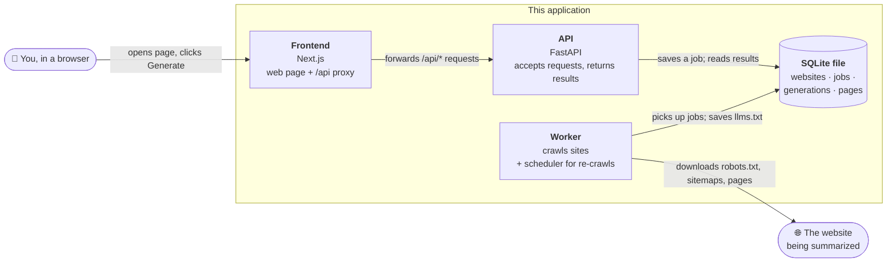
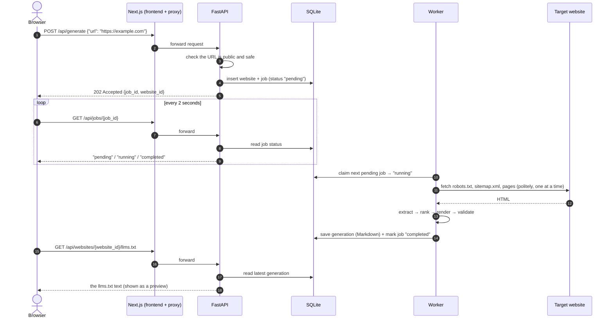
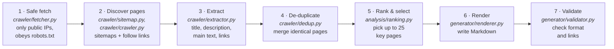
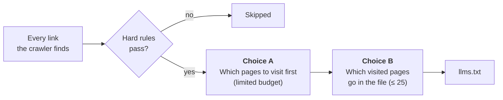
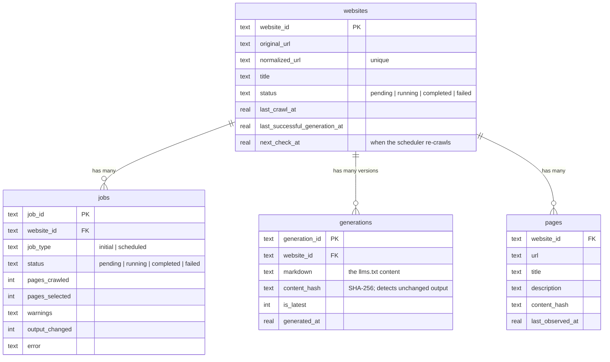
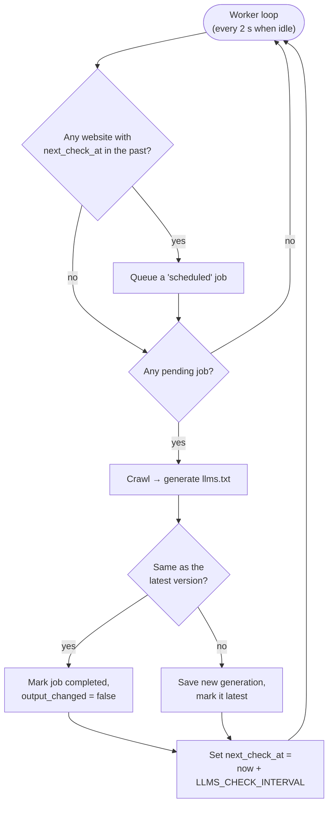
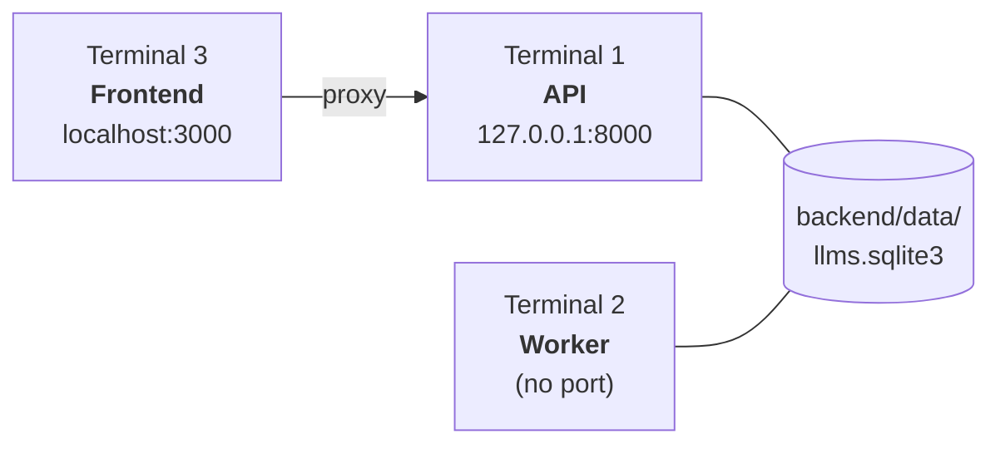
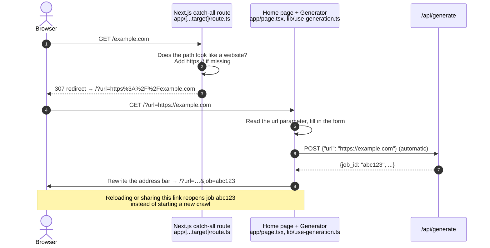
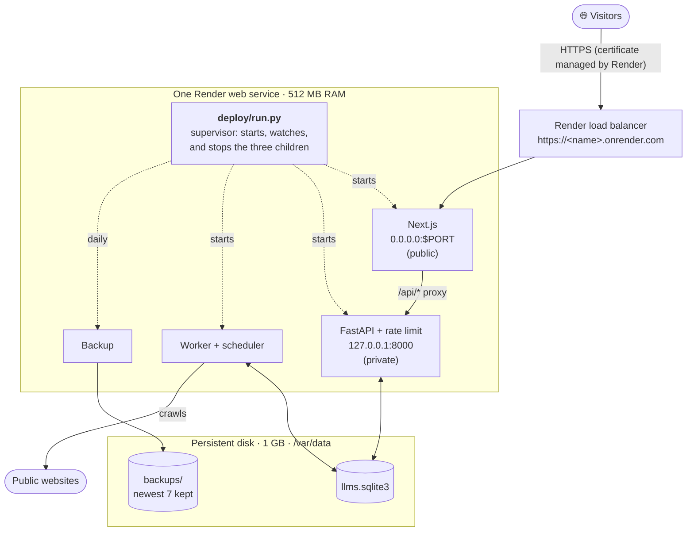
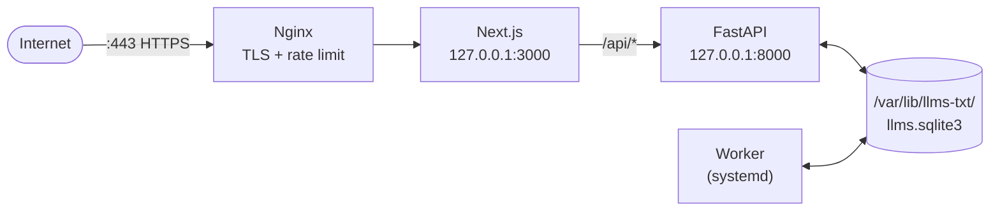

# Automated llms.txt Generator

Type in a website address and this app visits the site, reads its most important
pages, and writes an [`llms.txt`](https://llmstxt.org/) file for it. An
`llms.txt` file is a short Markdown summary of a website, with links, that is
meant to help AI assistants find their way around the site.

**Live app:** <https://llms-txt-jessica-ye.onrender.com>. Try
<https://llms-txt-jessica-ye.onrender.com/example.com>.

- **No AI or API keys needed.** The output is built by fixed rules
  (deterministic), not by a language model.
- **No Docker, Redis, or database server.** Everything is stored in one
  [SQLite](https://www.sqlite.org/) file.
- **Keeps itself up to date.** Sites you have generated before are re-crawled
  automatically (once a day by default). A new version is saved only if the
  output changed.
- **Three ways to use it:** a web app, a command-line tool (CLI), or an HTTP API.

```text
# Illustrative example of the output format (abridged)
# Python 3 Documentation

> The official documentation for the Python programming language.

## Tutorial
- [The Python Tutorial](https://docs.python.org/3/tutorial/): An informal introduction to Python…

## Library
- [The Python Standard Library](https://docs.python.org/3/library/): Reference for modules…
```

## Contents

1. [Key terms](#key-terms)
2. [How it works](#how-it-works)
3. [Repository layout](#repository-layout)
4. [Run it on your computer](#run-it-on-your-computer)
5. [Using the app](#using-the-app)
6. [Configuration](#configuration)
7. [Testing](#testing)
8. [Deploy to Render](#deploy-to-render)
9. [Operations: logs, backups, rollback](#operations-logs-backups-rollback)
10. [Troubleshooting](#troubleshooting)
11. [Limitations](#limitations)
12. [Project status](#project-status)

---

## Key terms

If you are new to web development, these are the terms used throughout this guide.

| Term | What it means here |
| --- | --- |
| **Frontend** | The part you see in the browser. Built with [Next.js](https://nextjs.org/) (a React framework), in `frontend/`. |
| **Backend / API** | A Python web server ([FastAPI](https://fastapi.tiangolo.com/)) that accepts requests such as "generate a file for this URL" and returns results. In `backend/app/api/`. |
| **Worker** | A separate, long-running Python process that does the slow work (crawling websites) in the background, so the API can answer quickly. |
| **Scheduler** | Code inside the worker that decides when a site is due for a re-crawl. It is not a separate program. |
| **Job** | One request to crawl a site. A job moves through `pending` → `running` → `completed` or `failed`. |
| **Generation** | One saved version of a site's `llms.txt`. A site can have many. |
| **Crawl** | Visiting a page, collecting its links, then visiting those pages, up to a limit. |
| **robots.txt / sitemap** | Files that websites publish to tell crawlers what they may visit (`robots.txt`) and which pages exist (`sitemap.xml`). This crawler obeys `robots.txt`. |
| **Proxy** | A middleman. The Next.js server passes the browser's `/api/...` requests on to FastAPI, so the browser only ever talks to one address. |
| **Environment variable** | A named setting (for example `LLMS_MAX_PAGES=40`) given to a program when it starts, instead of being written into the code. |
| **Virtual environment (venv)** | A private folder of Python packages for this project, so they don't clash with other projects. |
| **Render** | A hosting company. This repo includes a ready-made configuration (`render.yaml`) for it. |

---

## How it works

### The big picture

The app is made of **three programs** that cooperate, plus **one database file**:



The important idea: **the API never crawls.** Crawling can take minutes, so the
API only writes a "please crawl this" job into the database and answers right
away. The worker, running separately, picks up the job, does the crawl, and
saves the result. The browser keeps asking "is it done yet?" every two seconds.
Using the database as the job queue means no extra queue service (such as Redis)
is needed.

### What happens when you click "Generate"



### Inside the crawler

The same pipeline is used by the worker and by the command-line tool. It lives
in `backend/app/` and is split into small steps:



1. **Safe fetching.** Before every connection, the crawler looks up the site's
   IP address and refuses anything private (such as `127.0.0.1` or `10.x.x.x`).
   This stops someone from using the app to probe internal networks (an attack
   called SSRF). Redirects are checked the same way. Ordinary pages are capped at
   2 MB; sitemap downloads have separate streaming limits listed below.
2. **Discovering pages.** The crawler reads `robots.txt` and any sitemaps
   (including gzip-compressed ones), then prioritizes navigation links and
   different site sections so a small page budget covers more useful areas.
   Large sitemaps are streamed with byte, entry, and time limits. By default the
   crawler stays inside the folder you submitted. For example,
   `https://docs.python.org/3/` stays under `/3/`. It supports bare/`www.` hostname
   pairs and a limited number of meaningful query variants, checking robots
   permission for each destination origin.
3. **Extraction.** [BeautifulSoup](https://www.crummy.com/software/BeautifulSoup/)
   reads titles, descriptions, headings, and links.
   [Trafilatura](https://trafilatura.readthedocs.io/) pulls out the main body text.
4. **De-duplication.** Pages with identical content and metadata (for example
   `/docs/` and `/docs/index.html`) are merged into one.
5. **Ranking.** Each page gets a score from simple signals: how close it is to
   the start page, how often other pages link to it, whether it is in the
   navigation, whether it has a title and description, and how much content it has.
   Up to 25 pages are chosen, spread across the site's sections.
6. **Rendering.** The selected pages become Markdown: one `#` title, an optional
   `>` summary, and `##` sections of links.
7. **Validation.** The output is checked against the
   [llms.txt format](https://llmstxt.org/#format) and against the pages that
   were actually fetched.

### How pages are chosen

Every page must first pass a set of **hard rules**. The pages that pass are then
**ranked by importance**. The hard rules come from standards and safety needs.
The importance rules are educated guesses, checked against real websites (see
[How do we know it works?](#how-do-we-know-it-works)).



#### Hard rules (pass or fail)

| Rule | Why | Source |
| --- | --- | --- |
| Public websites only, never private or internal network addresses | Stops the app from being used to attack internal networks (SSRF) | Web-security practice (`crawler/fetcher.py`) |
| Obey `robots.txt`; at least 1 second between requests | Be a polite crawler | Web convention (`crawler/policy.py`) |
| Stay inside the submitted folder, on that hostname and its bare/`www.` twin | `docs.python.org/3/` should describe Python 3, not every version and language | Design choice made after testing on real sites (`crawler/urls.py`) |
| Skip login, signup, search, admin, cart, and checkout pages, `/page/N` pagination, and file downloads (PDF, images, archives, CSS/JS) | They aren't content pages and they waste the budget | `crawler/urls.py` |
| Stop at the page and depth budget (40 pages and depth 3 locally; 20 and 2 on Render) | Keep crawls fast and memory small | [Configuration](#configuration) |
| Output must be valid `llms.txt`: one `#` title, optional `>` summary, `##` link sections | That's the format | The [llms.txt spec](https://llmstxt.org/#format) (`generator/validator.py`) |

#### Choice A: which pages to visit first

The page budget is small, so the order matters. The crawler always picks the
highest-scoring page it knows about next (`crawler/frontier.py`):

1. The page you submitted always comes first.
2. Links in the site's **menu or header** come next, because the site owner put
   them there on purpose.
3. Then links **one click from the start page**.
4. Pages whose address or link text contains words such as *about, overview,
   docs, guide, tutorial, reference, products, pricing, contact* get a boost.
5. **Sitemap** URLs only fill leftover space, and can use at most ¾ of the budget.

The crawler also **spreads the budget across sections**. Each page it visits
in a section (for example `/blog/`) lowers the priority of the rest of that
section. Without this, a 20-page budget could be spent entirely on blog posts.

#### Choice B: which pages go into the file

Visited pages earn points (`analysis/ranking.py`) for:

- being the start page or close to it
- being linked from many other pages, especially from the menu
- having a real title and description
- having substantial content (capped, so very long pages don't dominate)
- having *overview, intro, about, tutorial, guide,* or *docs* in the address

Up to 25 winners are then picked **one per section in turn**, so the file
covers the whole site instead of ten pages from one corner. For the text of each
entry, the title comes from `<title>`, falling back to the first heading. The
description comes from the page's meta description, falling back to the first
real paragraph. Descriptions are shortened, never rewritten or invented.

> **In one sentence:** the pages a site features most (in its menu, near its
> homepage, linked often) are probably the ones that matter, and a good summary
> should cover every major section rather than go deep on one.

#### How do we know it works?

**Solid**

- The hard rules come from the llms.txt spec, robots.txt conventions, and
  security practice.
- 166 automated backend tests check that the code does what it was designed to
  do. For example, one test confirms that a small budget really is spread across
  sections. These tests show the code matches the design, not that the design
  is the best one.

**Measured, on a small scale**

- The [12-site benchmark](backend/benchmarks/README.md) covers a deliberately
  varied mix: documentation sites, a blog, a store, a government portal, NASA, a
  JavaScript app, and more. For each site, a person wrote down the key pages a
  good `llms.txt` should include, such as Python's Tutorial, Library, and
  Reference pages.
- After the crawl-priority changes, the number of sites passing every automated
  check went from **7 to 11 of 12**, and partial crawls went from 2 to 0. The
  twelfth site, NASA, passed after a wrong expected URL in the benchmark was
  corrected. See the
  [comparison report](backend/benchmarks/results-crawler-improvements.md).

### How data is stored

All state lives in one SQLite file (`backend/data/llms.sqlite3` locally,
`/var/data/llms.sqlite3` on Render). Tables are created automatically on first
start, so there are no migrations to run. The schema is in `backend/app/database.py`.



Each re-crawl compares the new Markdown's SHA-256 fingerprint with the latest
version. If it's identical, the job completes with `output_changed: false` and
no new version is stored. Older versions are kept and can be viewed in the app.

### How automatic re-crawling works



Only **one worker** may use a database at a time. It holds a lock file
(`llms.sqlite3.worker.lock`, next to the database), and a second worker exits with an error.
If the worker is stopped mid-crawl, that job is re-queued the next time it starts.

---

## Repository layout

```text
llms-txt-jessica-ye/
├── README.md                 ← you are here
├── render.yaml               ← Render hosting configuration ("Blueprint")
├── .node-version             ← Node.js version for Render (24)
├── .python-version           ← Python version for Render (3.13)
│
├── backend/                  ← Python: crawler, API, worker
│   ├── requirements.txt      ← Python packages to install
│   ├── .env.example          ← sample settings; copy to .env
│   ├── app/
│   │   ├── api/
│   │   │   ├── main.py       ← FastAPI routes (/api/generate, /api/jobs/…)
│   │   │   └── schemas.py    ← shapes of API requests/responses
│   │   ├── crawler/
│   │   │   ├── fetcher.py    ← safe HTTP fetching, robots.txt, rate limits
│   │   │   ├── sitemap.py    ← sitemap.xml discovery (incl. .gz)
│   │   │   ├── crawler.py    ← prioritized crawl
│   │   │   ├── extractor.py  ← pull title/description/text/links from HTML
│   │   │   ├── dedup.py      ← merge duplicate pages
│   │   │   └── urls.py       ← URL cleanup and scope rules
│   │   ├── analysis/ranking.py   ← score and select pages
│   │   ├── generator/
│   │   │   ├── renderer.py   ← build the llms.txt Markdown
│   │   │   └── validator.py  ← check the output
│   │   ├── generation.py     ← runs crawl → rank → render → validate
│   │   ├── database.py       ← SQLite tables and queries
│   │   ├── worker.py         ← background job runner (python -m app.worker)
│   │   ├── scheduler.py      ← decides when to re-crawl
│   │   ├── settings.py       ← reads LLMS_* environment variables
│   │   ├── config.py         ← crawler limits (CrawlConfig)
│   │   ├── cli.py            ← command-line tool (python -m app.cli)
│   │   └── benchmark.py      ← 12-site quality benchmark
│   ├── benchmarks/           ← benchmark site list and results
│   └── tests/                ← pytest tests (offline) + optional live runs
│
├── frontend/                 ← Next.js web app
│   ├── app/
│   │   ├── page.tsx          ← the main page
│   │   ├── api/[...path]/route.ts   ← proxy: /api/* → FastAPI
│   │   └── [...target]/route.ts     ← URL shortcut: /example.com → generate
│   ├── components/           ← URL form, status, preview, version picker
│   ├── lib/                  ← API client, types, job polling logic
│   ├── tests/                ← Playwright browser tests
│   ├── .env.example          ← sample settings; copy to .env.local
│   └── package.json
│
├── deploy/                   ← production-only helpers (used by Render)
│   ├── build.sh              ← install, test, and build everything
│   ├── run.py                ← starts API + worker + frontend together
│   ├── api.py                ← FastAPI app + submission rate limit
│   ├── backup.py             ← verified SQLite backups
│   └── test_deployment.py
│
└── docs/
    └── deploy-vps.md         ← alternative: self-host on an Ubuntu server
```

---

## Run it on your computer

These steps are for **macOS or Linux**. Windows isn't supported directly,
because the worker relies on Unix signals. On Windows, use
[WSL](https://learn.microsoft.com/windows/wsl/install) and follow the Linux steps.

### 1. Install the prerequisites

| Tool | Version | Check with | Get it from |
| --- | --- | --- | --- |
| Git | any | `git --version` | <https://git-scm.com/downloads> |
| Python | 3.11 or newer | `python3 --version` | <https://www.python.org/downloads/> |
| Node.js (includes npm) | 24 LTS recommended (20.19+ or 22.13+ also work) | `node --version` | <https://nodejs.org/> or [nvm](https://github.com/nvm-sh/nvm) |

### 2. Get the code

```sh
git clone https://github.com/yejessica/llms-txt-jessica-ye.git
cd llms-txt-jessica-ye
```

### 3. Start the three programs

You need **three terminal windows**, one per program, each opened in the
repository folder. Leave all three running.



**Terminal 1: the API**

```sh
cd backend
python3 -m venv .venv                      # create a private Python environment (first time only)
source .venv/bin/activate                  # turn it on (every time)
python -m pip install -r requirements.txt  # install packages (first time, or when requirements change)
test -f .env || cp .env.example .env       # create your settings file if it doesn't exist
set -a; source .env; set +a                # load the settings into this terminal
uvicorn app.api.main:app --host 127.0.0.1 --port 8000 --reload
```

You should see `Uvicorn running on http://127.0.0.1:8000`.

**Terminal 2: the worker**

```sh
cd backend
source .venv/bin/activate
set -a; source .env; set +a
python -m app.worker
```

> ⚠️ Without the worker, jobs stay **pending** forever. The API and worker must
> load the **same** `.env` file so that they use the same database file.

**Terminal 3: the frontend**

```sh
cd frontend
# If you use nvm: nvm install && nvm use
npm ci                                            # install packages (first time, or when package-lock.json changes)
test -f .env.local || cp .env.example .env.local  # points the proxy at http://127.0.0.1:8000
npm run dev -- --hostname 127.0.0.1
```

### 4. Try it

| Open | What it is |
| --- | --- |
| <http://localhost:3000> | The app |
| <http://127.0.0.1:8000/docs> | Interactive API documentation (try requests in the browser) |
| <http://localhost:3000/api/health> | Health check; should show `{"status":"ok"}` |

Enter `https://example.com`, click generate, and wait a few seconds. Then try
**Copy**, **Download**, and **Regenerate**. Larger sites can take a few minutes.

Stop each program with **Ctrl+C**. Your data stays in `backend/data/`. The next
time, you only need the `source` lines and the start commands; skip the
install steps unless dependencies changed.

> **Tip:** To see automatic re-crawling quickly, set `LLMS_CHECK_INTERVAL=10` in
> `backend/.env` and restart the API and worker. Sites will then re-crawl every
> 10 seconds instead of once a day.

---

## Using the app

### Web interface

Paste a URL, click generate, and watch the status. When it finishes you can
preview the Markdown, copy it, download `llms.txt`, regenerate it, or browse and
share links to **previous versions**. The app doesn't upload anything to the
target website. To publish an `llms.txt`, download it and place it at the root
of your own site (for example `https://yoursite.com/llms.txt`).

### URL shortcut

Put a website after the app's address to start generating straight away:

```text
http://localhost:3000/example.com
http://localhost:3000/https://example.com/docs/
```

Bare domains default to `https://`. After submission the address bar includes
the job ID, so you can reload or share that link to reopen the same result
without starting a new crawl. For URLs with `#` fragments or unusual characters,
use the encoded form: `/?url=https%3A%2F%2Fexample.com%2Fdocs%3Fversion%3D2`.

#### How the shortcut works

The shortcut is just a **redirect**. When you visit
`https://<app>/example.com`, the browser asks the app's server for a page whose
*path* is `/example.com`. No such page exists, so the server translates that path
into a normal "generate this URL" request and sends the browser there.



Step by step:

1. **Catching the path.** Next.js tries its real routes first: the home page,
   `/api/*`, and static files. Anything left over goes to the catch-all route
   `frontend/app/[...target]/route.ts`. The `[...target]` folder name means
   "match any path".
2. **Checking it's a website.** The route only accepts paths that look like a
   domain (a dot in the first part, such as `example.com`) or that start with a
   scheme (`https:/…`). Anything else, such as `/foo`, gets a normal
   **404 Not Found**, so typos don't trigger crawls.
3. **Fixing up the address.** Browsers and Next.js collapse double slashes, so
   a pasted `https://example.com` arrives as `https:/example.com`. The route
   restores the `//`. A bare domain gets `https://` added in front. Any `?query`
   on the end is kept unchanged.
4. **Redirecting.** The route answers with an HTTP **307 redirect** to
   `/?url=<the encoded target>`. The redirect uses a relative address (`/?url=…`,
   not a full `https://host/…`). This keeps the browser on the app's public
   address even behind Render's proxy, where the server's own internal address
   is `0.0.0.0:10000`. It is also marked `no-store` so the browser doesn't cache it.
5. **Auto-generating.** The home page reads the `url` parameter and passes it
   to the generator. The generator validates it and immediately submits it, as
   if you had clicked **Generate**. The backend still runs its full safety
   checks, robots rules, rate limit, and page budget. If the same site is already
   being crawled, the backend returns that existing job instead of starting a
   second one.
6. **Making the link shareable.** Once the job exists, the page rewrites the
   address bar to `/?url=…&job=<job_id>`. It uses `history.replaceState`, so this
   doesn't add an extra Back-button entry. Opening a link that has `job=` resumes
   watching that job rather than submitting a new crawl. Viewing an older
   version adds `&version=<generation_id>` in the same way.

The address is the source of truth. A shortcut or a `?url=` link starts a job,
and a `?url=…&job=…` link reopens one. A plain visit to `/` resumes the last
in-progress job from this browser tab, which is saved in `sessionStorage`.

> **Why `#` fragments are lost:** browsers never send the part after `#` to a
> server, so the route can't see it. Use the encoded `?url=` form for those.

### Command-line tool (no web app needed)

The CLI runs the crawler once and writes files to disk. It doesn't use the
database or the worker.

```sh
cd backend
source .venv/bin/activate
python -m app.cli generate https://example.com

python -m app.cli generate https://docs.python.org/3/ \
  --max-pages 30 --max-depth 3 \
  --output ./output/python-llms.txt --verbose
```

| Flag | Default | Meaning |
| --- | --- | --- |
| `--max-pages` | 40 | Maximum pages to try fetching (1–1000) |
| `--max-depth` | 3 | How many links away from the start page to go (0–20) |
| `--crawl-scope` | `directory` | `directory` = stay in the submitted folder; `site` = whole hostname |
| `--delay` | 1.0 | Minimum seconds between requests (robots.txt may raise it) |
| `--output` | auto | Where to write the `.txt`; a `.stats.json` is written beside it |
| `--verbose` | off | Log every page |

Exit codes: `0` success (a partial crawl that still produced useful output
counts as success, with a warning), `1` crawl or output failure, `2` invalid
arguments.

### HTTP API

All endpoints are under `/api`. Locally you can call FastAPI directly on port
8000; in production, go through the app's public address.

| Method | Endpoint | What it does |
| --- | --- | --- |
| POST | `/api/generate` | Body `{"url": "..."}`. Queues a crawl and returns `202` with `job_id`, `website_id`, `status` |
| GET | `/api/jobs/{job_id}` | Job status, timestamps, page counts, warnings, error, `output_changed` |
| GET | `/api/websites/{website_id}` | Website info and latest generation metadata |
| GET | `/api/websites/{website_id}/llms.txt` | Latest `llms.txt` as plain text |
| GET | `/api/websites/{website_id}/download` | Same, as a file download |
| POST | `/api/websites/{website_id}/refresh` | Queue a fresh crawl (`202`) |
| GET | `/api/websites/{website_id}/generations` | List of all saved versions, newest first |
| GET | `/api/websites/{website_id}/generations/{generation_id}` | One older version as plain text |
| GET | `/api/health` | `{"status":"ok"}` if the API and database are reachable |

```sh
curl -X POST http://127.0.0.1:8000/api/generate \
  -H 'Content-Type: application/json' -d '{"url":"https://example.com"}'
# copy job_id and website_id from the response:
curl http://127.0.0.1:8000/api/jobs/JOB_ID
curl http://127.0.0.1:8000/api/websites/WEBSITE_ID/llms.txt
```

Errors always look like `{"error": {"code": "...", "message": "..."}}`. Common
statuses: `404` not found or not ready yet, `422` invalid or unsafe URL, `429`
too many submissions (production only), `503` database unavailable. If you
submit a URL that is already being crawled, you get the existing job back
instead of a duplicate.

---

## Configuration

### Backend (`backend/.env`, used by the API and the worker)

All times are in seconds. The local `.env` file isn't loaded automatically,
which is why the commands above run `set -a; source .env; set +a`.

| Variable | Default | What it controls |
| --- | --- | --- |
| `LLMS_DB_PATH` | `backend/data/llms.sqlite3` | The SQLite database file. API and worker must match. |
| `LLMS_CHECK_INTERVAL` | `86400` (1 day) | Time between automatic re-crawls of a site |
| `LLMS_POLL_INTERVAL` | `2` | How often an idle worker checks for new jobs |
| `LLMS_JOB_TIMEOUT` | `300` | Maximum time for one whole crawl |
| `LLMS_MAX_PAGES` | `40` | Maximum pages to fetch per crawl (1–1000) |
| `LLMS_MAX_DEPTH` | `3` | Maximum link distance from the start page (0–20) |
| `LLMS_REQUEST_TIMEOUT` | `15` | Timeout for a single network request |
| `LLMS_REQUEST_DELAY` | `1` | Minimum gap between requests to the same site |
| `LLMS_CRAWL_SCOPE` | `directory` | `directory` or `site` (see CLI `--crawl-scope`) |
| `LLMS_MAX_SITEMAP_BYTES` | `52428800` (50 MiB) | Maximum decompressed XML bytes per sitemap |
| `LLMS_MAX_SITEMAP_COMPRESSED_BYTES` | `10485760` (10 MiB) | Maximum compressed bytes per gzip sitemap |
| `LLMS_MAX_SITEMAP_ENTRIES` | `50000` | Maximum entries per sitemap |
| `LLMS_MAX_SITEMAP_TOTAL_BYTES` | `67108864` (64 MiB) | Combined XML byte budget for sitemap discovery |
| `LLMS_SITEMAP_TIMEOUT` | `30` | Maximum seconds for sitemap discovery |
| `LLMS_MAX_QUERY_VARIANTS` | `5` | Maximum query variants per hostname and path |
| `LLMS_SUBMISSIONS_PER_MINUTE` | `6` | *Production only* (`deploy/api.py`): shared rate limit for generate/refresh |
| `LLMS_SUBMISSION_BURST` | `3` | *Production only*: how many submissions can arrive at once before limiting starts |

Other crawler limits (response size, number of sitemaps, retry rules, user agent)
are in `backend/app/config.py`.

### Frontend (`frontend/.env.local`)

| Variable | Example | What it controls |
| --- | --- | --- |
| `BACKEND_URL` | `http://127.0.0.1:8000` | Where the Next.js proxy forwards `/api/*`. **No `/api` on the end.** Read only on the server, never in the browser. Required in production. |

Restart the program after changing any environment file.

---

## Testing

```sh
# Backend: about 120 offline tests; they never touch the real internet
cd backend && source .venv/bin/activate
python -m pytest -q

# Deployment helpers (run from the repository root)
backend/.venv/bin/python -m pytest deploy/test_deployment.py -q

# Frontend: code style, type checks, production build
cd frontend
npm run lint
npm run typecheck
npm run build

# Frontend browser tests with a fake API (needs Google Chrome installed)
npm test

# Optional end-to-end test: real API + worker + example.com (needs internet)
npm run build && npm run test:live
```

Optional live backend checks (these need internet access):

```sh
cd backend && source .venv/bin/activate
python tests/run_backend_live.py   # API + worker against example.com, incl. restart
python tests/run_live.py           # real CLI against the 12-site benchmark
python -m app.benchmark --only example --only python-docs
```

The [coverage benchmark](backend/benchmarks/README.md) measures how well the
crawler finds the key pages of 12 real sites. The
[crawler improvements comparison](backend/benchmarks/results-crawler-improvements.md)
records the newer run alongside the
[original results](backend/benchmarks/results-2026-10-16.md). Automated candidates
still need manual content review.

---

## Deploy to Render

[Render](https://render.com/) runs the whole app as **one web service** with a
**persistent disk** for the SQLite file. The configuration is already in
`render.yaml`, so you don't need a server, Docker, or SSL certificates of your own.

### What gets deployed



**Why everything runs in one service:** a Render disk can only be attached to
one service, and the API and worker must share the SQLite file. `deploy/run.py`
starts all three programs inside that single service. If any of them crashes,
it stops the rest so Render restarts the whole service cleanly.
**Don't add a separate worker service or scale to more than one instance.**

| Setting (from `render.yaml`) | Value |
| --- | --- |
| Runtime / region | Python (Node is also available) / Virginia |
| Instance plan | `0.5c-512mb` (512 MB RAM) |
| Disk | 1 GB at `/var/data` |
| Build command | `bash deploy/build.sh`: installs dependencies, runs **all tests**, builds the frontend |
| Start command | `python -m deploy.run` |
| Health check | `/api/health` |
| Crawl limits | 20 pages, depth 2, 180 s per job, 1 s between requests |
| Re-crawl | Every 24 hours |
| Submission limit | 6 per minute shared across all visitors, bursts of up to 3 |
| Backups | 30 s after start, then daily; newest 7 kept |
| Auto-deploy | Off (you choose when to deploy) |

**Cost:** about **$7/month** for compute plus **$0.25/month** for the 1 GB
disk, charged by the second (around $0.24/day). The free plan can't be used,
because it doesn't support persistent disks. Check
[Render pricing](https://render.com/pricing) before creating anything.

### Step-by-step

1. **Put the code on GitHub.** Fork this repository (or push your copy to your
   own GitHub repository). Render deploys from GitHub.
2. **Create a Render account** at <https://dashboard.render.com/> (the free
   "Hobby" workspace is fine) and add a payment method when asked.
3. **Create the Blueprint.** In the dashboard choose **New → Blueprint**, connect
   GitHub, and pick your repository. For the original repo you can use
   [this one-click link](https://render.com/deploy?repo=https://github.com/yejessica/llms-txt-jessica-ye).
   Render reads `render.yaml`. Keep the **repository root** as the root
   directory, not `frontend/`.
4. **Review and confirm.** You should see exactly **one web service and one
   disk**. Don't add Postgres, Redis, or a worker.
5. **Wait for the build** (several minutes). If it fails, open the service's
   **Events → build logs**. The build runs the full test suite, so a failing
   test stops the deploy on purpose.
6. **Open your app** at the `https://<name>.onrender.com` address Render gives you.

### Check that it works

- [ ] `https://<your-app>/api/health` returns `{"status":"ok"}`
- [ ] `http://<your-app>` redirects to `https://`
- [ ] Generating `https://example.com` completes, and the preview, copy,
      download, and regenerate all work
- [ ] The page looks right on a phone-sized screen
- [ ] After **Manual Deploy → Restart service**, the earlier result is still there
- [ ] Logs show `Verified backup: /var/data/backups/...`
- [ ] Memory under **Metrics** stays well below 512 MB during a crawl

Because auto-deploy is off, deploy updates yourself: push to GitHub, then
choose **Manual Deploy → Deploy latest commit**, or deploy a specific commit.

### Prefer your own server?

[`docs/deploy-vps.md`](docs/deploy-vps.md) is a full tutorial for one Ubuntu
24.04 server with systemd, Nginx, Let's Encrypt HTTPS, a firewall, and cron
backups. The same three programs run there, with Nginx in front:



---

## Operations: logs, backups, rollback

All of this happens in the Render dashboard for your service.

| Task | How |
| --- | --- |
| **Read logs** | **Logs** tab. Lines from the API, worker, frontend, and supervisor are combined; the worker logs every finished or failed job. |
| **Watch resources** | **Metrics** tab: memory, CPU, and disk. Out-of-memory crashes show up here. |
| **Restart** | **Manual Deploy → Restart service**. Interrupted jobs are re-queued automatically. |
| **Roll back code** | **Manual Deploy → Deploy a specific commit**, and pick the last good one. Data on the disk is kept. |
| **Shut down** | Download any backups you want to keep, then **delete the service and its disk**, then check **Billing**. Turning off auto-deploy doesn't stop charges. |

**Backups.** Run these in the service's **Shell** tab:

```sh
python deploy/backup.py                    # make a backup now
ls -l /var/data/backups                    # list backups
python deploy/backup.py --verify /var/data/backups/CHOSEN_SNAPSHOT.sqlite3
```

Backups use SQLite's online backup feature, so they are consistent even while
the app is running, and each one is test-restored before it is kept. They live on
the **same disk** as the database, so they don't protect against deleting the
service. Download important ones elsewhere.

**Restoring a backup** means replacing the live database, and that is only safe
while every program is stopped. The supervisor restarts programs automatically,
so don't swap files from a normal Shell session. Instead, temporarily change the
start command so nothing runs, move the old `llms.sqlite3`, `-wal`, and `-shm`
files aside together, copy in a verified snapshot, then restore the start
command. Rehearse with `--verify` first.

---

## Troubleshooting

| Symptom | Likely cause and fix |
| --- | --- |
| Job stays **pending** forever | The worker isn't running, or it uses a different `LLMS_DB_PATH` than the API. Start it, and load the same `.env` in both terminals. |
| `Another worker is already using this database` | A second worker is running. Stop it. Never delete the lock file to force it. |
| App says it can't reach the generation service | Terminal 1 (API) isn't running, or `BACKEND_URL` in `frontend/.env.local` is wrong (it must not end in `/api`). |
| `uvicorn: command not found` / `No module named app` | The virtual environment isn't active (`source .venv/bin/activate`), or you aren't in `backend/`. |
| `Too many requests` / HTTP 429 | The production submission limit was hit. Wait a minute. |
| The result has few or no pages | The site may build its pages with JavaScript (unsupported), block crawlers in `robots.txt`, or rate-limit requests. Check the job's warnings. |
| Render build fails | A test failed or a dependency didn't install. Read the build log in **Events**. |
| Render service keeps restarting | Probably out of memory. Check **Metrics**, lower `LLMS_MAX_PAGES`, or upgrade the plan. |

---

## Limitations

- **No JavaScript rendering.** Sites that only show content after JavaScript
  runs produce thin output.
- **Ranking is rule-based.** It doesn't understand page meaning, so selections
  can miss important pages. The [benchmark](backend/benchmarks/README.md)
  measures this.
- **One crawl at a time.** Crawling is deliberately serial and polite, so large
  sites take minutes and jobs wait in line.
- **Limited URL variants.** Only the submitted hostname and its exact bare/`www.`
  counterpart are followed; other subdomains are excluded. Query crawling is
  bounded, and tracking, sorting, session, and pagination parameters are filtered.
- **No user accounts.** Anyone with a result's ID can view it. The rate limit is
  shared by all visitors and resets on restart. This setup is meant for a small
  demo, not a public service.
- **Health check scope.** `/api/health` confirms the frontend, API, and database
  are reachable. It doesn't confirm the worker is crawling.
- **SQLite on one machine.** No Windows, network drives, or multiple instances.
  Deploys and restarts cause a short downtime.
- **Unpinned Python dependencies.** `requirements.txt` uses version ranges, not
  a lockfile. Run `pip freeze` after a working deploy if you need an exact record.

---

## Project status

| Area | Status |
| --- | --- |
| Crawler + CLI | Complete |
| API, database, worker, automatic re-crawls | Complete |
| Web frontend, URL shortcuts, version history | Complete |
| Render deployment | **Live** at <https://llms-txt-jessica-ye.onrender.com>, serving over HTTPS with HTTP redirected to HTTPS |
| Ubuntu VPS guide | Written; not yet run on a real server |

Verification as of October 2026: the public Render deployment is working, and
locally, the backend tests, the deployment tests,
the frontend lint, type check, and build, the mocked browser tests on desktop
and mobile, and a live end-to-end `example.com` run (generate, download,
refresh, automatic re-crawl, unchanged-output detection, and persistence across
restarts) all pass.
